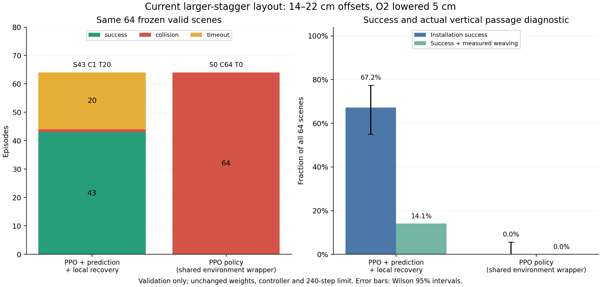

# Learning Agent C&R: Joint-Space PPO for Wall-Panel Installation

## 1. Task and learning formulation

The task is to carry a rigid wall panel to a fixed installation pose while avoiding moving obstacles. We implement a continuous-control Gymnasium environment using a seven-joint KUKA LBR iiwa in PyBullet. The small panel measures **0.30 × 0.20 × 0.03 m** and is attached to the end effector by a fixed constraint. Four unequal boxes move in three dimensions. Their displacement-vector and speed bounds are **0.18 m** and **0.12 m/s**. The current layout places them at alternating offsets of **14–22 cm** from a preliminary execution route, with obstacle O2 lowered by another 5 cm. After this adjustment, anchor-height span and adjacent height differences must exceed 35 cm and 14 cm, respectively.

The learning objective is the expected discounted episode return, with discount factor 0.99. The **77-dimensional observation** contains normalized joint positions (7), joint velocities (7), target position and orientation errors (3 + 3), five obstacle slots (5 × 10), and the next reference joint waypoint (7). Each obstacle slot contains relative center (3), dimensions (3), velocity (3), and presence (1). Four slots are active; the fifth is padded. The **7-dimensional action** specifies normalized joint increments. The projected command is

\[
q_t^{\mathrm{cmd}}=q_t+\Delta_q\tilde a_t,
\qquad \Delta_q=4^\circ,
\]

where the environment clips/project actions to the actuator and joint bounds. Motor control and physical simulation then execute the command; actions do not teleport the robot. Each control step contains 12 physics substeps at 1/240 s, giving a 20 Hz control rate. Success requires position error below **1 cm**, orientation error below **2°**, and no collision or joint-limit violation. Episodes stop on success/collision/violation, or truncate after **240 control steps**.

The raw reward used by the packaged environment is

\[
\begin{aligned}
r_t={}&100(d_t-d_{t+1})+12(\phi_t-\phi_{t+1})
-0.015\|\tilde a_t\|^2-0.05\\
&-50I_C-30I_J+100I_S
+0.25\frac{\|q_t^{ref}-q_t\|-\|q_t^{ref}-q_{t+1}\|}{\Delta_q}
-0.5\operatorname{clip}(1-c_t/0.08,0,1)^2.
\end{aligned}
\]

Here, \(d\) is target position error in metres, \(\phi\) is orientation error in radians, and \(c_t\) is minimum obstacle clearance, capped at 0.08 m. Indicators denote collision, joint violation, and success. The same local reference is used on both sides of the waypoint-progress term. Training multiplies the resulting reward by 0.01; evaluation reports physical outcomes using the original criteria.

## 2. Code explanation and learning agent

The submitted checkpoint uses **Stable-Baselines3 PPO with a custom `MultiObstaclePolicy`**. A frozen tracking prior supplies a base action. A trainable multi-obstacle correction receives the observation, local joint-reference error, and base action: 91 inputs, two 128-unit Tanh hidden layers, and seven outputs. Presence and goal-distance masks gate this correction. The critic has two 128-unit hidden layers. This keeps the original tracking structure while allowing obstacle-dependent adaptation.

Earlier development used **behaviour cloning (BC)** from collision-checked RRT demonstrations to initialize/improve tracking. PPO subsequently optimizes policy-generated trajectories using its clipped probability-ratio objective. The included imitation utilities keep teacher data separate from PPO's on-policy rollout buffer. The portable training entry continues PPO; it does not insert expert or predictive-controller actions into that buffer.

The saved checkpoint records 64,000 cumulative timesteps from earlier experiments, not 64,000 steps of training on the latest layout. Its stored PPO settings include learning rate **3 × 10⁻⁶**, rollout length 250, batch size 100, three epochs, clip range 0.05, GAE parameter 0.95, target KL 0.005, and value coefficient 0.1. The short submission trainer uses 64-step rollouts and batch size 32 for practical software checks; its defaults are explicitly separate from the historical checkpoint schedule.

| Location | Main responsibility |
|---|---|
| `src/wall_panel_rl/envs/`, `control/` | Physics, panel attachment, observations, reward, collision checks, motor commands |
| `rl/multi_obstacle_adapter.py` | Custom actor/critic policy and trainable-parameter mask |
| `rl/waypoint_ppo.py`, `avoidance_curriculum.py`, `conditional_recovery.py` | Action projection, reference tracking/recovery, reward shaping |
| `planning/`, `baselines/classical.py` | IK, RRT, time-dependent path scheduling and separate planner baseline |
| `rl/predictive_safety.py`, `progress_recovery.py` | Optional execution-time prediction and local recovery |
| `scripts/train_agent.py`, `evaluate_agent.py` | Portable PPO continuation and frozen-case evaluation |
| `visualization/episode_replay.py` | Fixed-frame-rate playback of recorded physical states |

The enhanced controller tests candidate speed changes over a 12-step prediction horizon. On stagnation it can search 36-step local recovery actions, with at most three accepted recoveries. Simulator state, reference state, random state, and physical time are restored after hypothetical trials. This is **PPO plus model-based execution control**, not a claim that PPO independently learned all avoidance behaviour. RRT is available as a separate baseline; it is not a hidden fallback in the enhanced PPO branch.

## 3. Experimental results and demonstration

The latest study froze the model, controller, and **64 new valid layouts** before final-layout execution. Scene preparation used a preliminary physical trajectory as a placement guide, without selecting on its success. Of 285 construction attempts, 220 were rejected, 64 valid scenes were selected in seed order, and one additional valid scene was unused. Final outcomes were never replaced by successful retries. The two evaluated modes started from exactly matching physical states.

| Execution mode | Success | Collision | Timeout | Installation success |
|---|---:|---:|---:|---:|
| PPO + prediction + local recovery | 43 | 1 | 20 | **67.2%** |

The enhanced installation-rate Wilson 95% interval is **55.0–77.4%**. Its 20 timeouts met the predefined waiting/stagnation diagnostic; mean terminal errors were approximately 0.379 m and 50.2°, indicating more than a final precision problem. No joint-limit failures occurred. These are validation results with unchanged weights and no new optimizer updates, not independent final-test or converged-training claims. Geometric validity also does not prove every scene is solvable within the fixed budget.

Installation success and vertical weaving are different outcomes. A secondary diagnostic requires successful installation plus at least three ordered near-box passages with alternating whole-panel above/below clearance and actual rise/fall. **9/64 scenes (14.1%)** met both conditions. Full definitions, counts, paired outcomes, and plots are in `experiments/`.

The attached selected demonstration, seed **1166026**, succeeds in **239 steps**, with approximately **1.17 mm** position error and **0.094°** orientation error. It passes below O1, above O2, and below O4 with measured whole-panel vertical clearance. The requested motion excerpt contains only the contiguous real states from steps **155–239**; it omits initial waiting from display, not from the episode result. The complete recording is also supplied. This selected example is not used as evidence of overall success rate. Playback interpolates recorded poses at 60 FPS and 0.6× speed; it runs no new planning or physics.

## 4. Existing codes, libraries, and external resources

We use [Gymnasium](https://gymnasium.farama.org/api/env/) for the environment API, [Stable-Baselines3](https://stable-baselines3.readthedocs.io/en/master/modules/ppo.html) for PPO, and PyTorch for neural networks/automatic differentiation. [PyBullet/Bullet](https://github.com/bulletphysics/bullet3) provides rigid-body simulation, FK/IK queries, and collision geometry. NumPy/SciPy support numerical and rotation operations; Matplotlib produces experiment figures. These libraries implement substantial infrastructure; we do not claim to have implemented PPO or a physics engine from scratch.

The KUKA URDF and meshes are copied from `pybullet_data` and retain their original notices. The environment geometry, observation/action design, rewards, custom policy adapters, reference handling, predictive execution controller, experiment orchestration, and recording/replay integration are project code. No Gazebo server, ROS installation, or physical robot is required. Exact Python/package pins are in `environment.yml`; asset attribution is in `assets/README.md` and `THIRD_PARTY_NOTICES.md`. AI coding assistance was used for implementation and documentation; computational claims are supported by the included logs and tests.

## 5. Reflections and lessons learned

The initial Cartesian-action idea was replaced with joint-space commands to expose actuator limits and link-level collision checking. We first used a small rigid panel and simpler scenes, then introduced four moving, vertically staggered obstacles. Delays were omitted, and the latest reported experiments use zero sensing noise. Earlier noise-related work is not presented as a validated result for this new layout.

A major lesson was that an attractive successful animation can conceal weak policy generalization. The pure PPO result and the enhanced result must be reported separately. Likewise, reaching the target does not guarantee the desired above/below route. Larger height offsets and execution-route-based placement created a distribution shift that the retained policy had not mastered. Waiting reduces some collisions but consumes the episode budget and can still become unsafe around moving objects.

The current system assumes known obstacle motion and pauses physical time during planning/prediction. It uses simplified box geometry and a rigid grasp, with no perception pipeline, communication delay, grasp failure, or real-time deployment validation. Future work should expand the training bank, use verified dynamic demonstrations, apply staged BC/PPO adaptation, and improve recovery/reference handover. Models should be selected on validation data and assessed once on a fresh final test set. Continuous real-time execution and noisy sensing should be introduced after the controlled baseline is stable.
