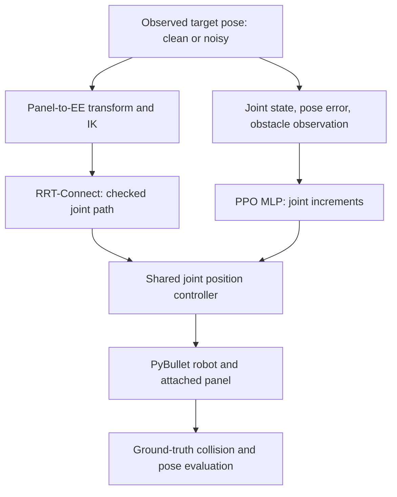

# Reinforcement Learning for Collision-Aware Robotic Wall Panel Installation

Can a PPO joint-space policy learn collision-aware panel manipulation and maintain
accurate alignment under target measurement noise, compared with sampling-based
planning and feedback control?

This repository contains a runnable PyBullet/Gymnasium environment, SB3 PPO
training, a project-implemented bidirectional RRT-Connect, fixed-seed evaluation,
CSV summaries, plots and graphical demos. The seven-joint KUKA iiwa holds a
0.30 × 0.20 × 0.03 m rigid panel. Success requires <1 cm position error and <2°
orientation error, without collision. There is **no observation delay**.

## Install

From this repository root:

```bash
conda env create -f environment.yml
conda activate wall-panel-rl
# If your shell previously sourced ROS, clear its unrelated Python plugins:
unset PYTHONPATH
python scripts/smoke_test.py
pytest -q
```

Python and direct library versions in `environment.yml` are the actual tested
versions. CPU PyTorch is pinned; no CUDA or GPU is required. A pip alternative
using Python 3.11.5 is:

```bash
python -m venv .venv
source .venv/bin/activate
python -m pip install -r requirements.txt
python scripts/smoke_test.py
python -m pytest -q
```

Scripts add `src/` to their import path; an editable install is unnecessary.
Run commands from the repository root. The smoke test verifies stages A/B/C,
SB3's API checker, IK, RRT and physical installation. No full training occurs.

## Methods and configuration

PPO: a 41-element observation contains normalized q (7), dq (7), relative target
position (3), relative rotation vector (3), and three obstacle slots (7 each:
relative center, dimensions, presence). Missing slots are zero. A two-layer
128-unit ReLU MLP outputs seven normalized increments. Each action produces
`q_des = clip(q + action * radians(4), joint_limits)`. Attempted limit violations
are penalized and terminate; clipping does not silently hide them.

Both methods execute using the same Bullet joint position controller, 240 Hz
physics and 12 physics steps per high-level decision. The panel is attached by a
fixed constraint. Collisions include robot/panel versus obstacles and wall,
nonadjacent self-collision, and panel versus non-gripped links.

The reward is

```text
100 * (previous_position_error - position_error)
+ 12 * (previous_orientation_error - orientation_error)
- 0.015 * sum(action**2) - 0.05
- 50 * collision - 30 * joint_limit_violation + 100 * success
```

Orientation errors in the reward are radians. Terminal events use ground truth.
The controller observation alone has target measurement noise: independently
sampled Gaussian translation (5 mm per axis) and rotation-vector (0.5° per axis).
The clean condition uses zero noise. Joint state and obstacle geometry are exact.

RRT takes the **same first noisy target observation**, converts panel pose to
end-effector pose, solves multistart IK, then grows and connects two joint-space
trees. Edges are checked every 0.035 rad; configurations have a 5 mm planning
clearance. It follows the resulting waypoints through the common controller.
It plans once, rather than updating its target after every observation. PPO gets
fresh target observations each step. This experimental distinction is deliberate
and documented in `DECISIONS.md`; neither receives a secretly perfect target.
A noisy planned goal can lie outside the true success tolerance.



All parameters are in `configs/base.yaml`; other YAMLs inherit and override it.
Stages: A = no boxes; B = one fixed sparse box; C = 1–3 randomized sparse boxes.
Start/goal overlap is rejected. Sparse sampling does not mathematically guarantee
a connecting path. Failures stay in the reported denominator.

## Training

Each run requires a unique name and saves resolved config, provenance, Monitor
CSV, TensorBoard logs, periodic checkpoints, best evaluation model and final model.
No VecNormalize is used. SB3 rounds timesteps up to complete rollout buffers.

```bash
python scripts/train_ppo.py --config configs/base.yaml \
  --total-timesteps 50000 --run-name my_phase1 --seed 42
python scripts/train_ppo.py --config configs/phase1_alignment.yaml \
  --resume models/my_phase1/final_model.zip \
  --total-timesteps 30000 --run-name my_alignment --seed 42
python scripts/train_ppo.py --config configs/base.yaml \
  --resume models/my_alignment/final_model.zip \
  --total-timesteps 50000 --run-name my_restored --seed 42
python scripts/train_ppo.py --config configs/stage_b_curriculum.yaml \
  --resume models/my_restored/final_model.zip --zero-obstacle-inputs \
  --total-timesteps 30000 --run-name my_phase2 --seed 42
python scripts/train_ppo.py --config configs/train_clean.yaml \
  --resume models/my_phase2/final_model.zip \
  --total-timesteps 100000 --run-name my_clean --seed 42
python scripts/train_ppo.py --config configs/train_noise.yaml \
  --resume models/my_phase2/final_model.zip \
  --total-timesteps 100000 --run-name my_noise --seed 42
```

The alignment run uses nearby initial states. Obstacle training mixes 25% nearby
and 75% original starts to retain precision learning; evaluation always disables
this mixture. The measured unsuccessful earlier attempts are retained separately. The one-time
`--zero-obstacle-inputs` transfer flag clears weights on features that were always
zero in Stage A, preserving the learned policy when obstacle slots become active.
Those weights remain trainable; do not apply this flag to the final branches.

Both final variants should branch from the same no-noise curriculum checkpoint
with equal additional budgets. Inspect learning first; these commands alone do
not guarantee convergence. `--device cpu` is the default; `--render` enables GUI.
`tensorboard --logdir models` displays training and reward-component logs.

## Evaluation and plots

The primary comparison uses each run’s best callback-validation checkpoint,
selected by mean return before the fixed benchmark is run. Final checkpoints
are also retained. Use the supplied models, or substitute paths to your own:

```bash
python scripts/evaluate.py --config configs/eval_clean.yaml \
  --clean-model models/ppo_clean/best/best_model.zip \
  --noise-model models/ppo_noise/best/best_model.zip --run-id my_eval_clean
python scripts/evaluate.py --config configs/eval_noise.yaml \
  --clean-model models/ppo_clean/best/best_model.zip \
  --noise-model models/ppo_noise/best/best_model.zip --run-id my_eval_noise
python scripts/plot_results.py --inputs \
  results/raw/my_eval_clean/episodes.csv results/raw/my_eval_noise/episodes.csv
```

Each command defaults to 100 scenarios (seeds 10000–10099) per method, with noise
seeds offset by 1,000,000. Scene and noise RNGs are separate. The script asserts
that all methods received identical initial configurations, obstacles and targets,
and saves these in `scenarios.json`. `--episodes N` changes the count; `--methods
rrt` evaluates only the planner. Run IDs cannot overwrite existing raw results.

Alternatively, `python scripts/benchmark.py --prefix my_benchmark` runs both
conditions and plots all six cells. Final metrics always use true simulated poses.
Continuous metrics include mean, sample standard deviation and count. Planning
and IK fields for PPO are intentionally missing. Wall-clock timings depend on
hardware and concurrent load; path lengths are summed at physics substeps.

`python scripts/verify_detour.py` demonstrates a real robot case in which the
straight joint path is blocked and RRT executes an alternative. This diagnostic
is distinct from the sparse random benchmark, where many direct paths are valid.

## Graphical demo

```bash
python scripts/demo.py --method rrt
python scripts/demo.py --method ppo --model models/ppo_clean/best/best_model.zip
python scripts/demo.py --method ppo --model models/ppo_noise/best/best_model.zip \
  --config configs/eval_noise.yaml
```

The GUI shows the robot, orange panel, green target, red obstacles, grey wall and
blue trajectory; the console prints errors, collision and success each step.
Seed 10002 is the default, selected as a successful demonstration scene; the
benchmark retains all 100 seeds and its failures. The window closes after the episode plus five seconds;
change `--hold-seconds` as needed. Each run also saves a rendered snapshot.

On the development Linux host, Conda's C++ runtime conflicted with Mesa. This
verified workaround selects the system runtime:

```bash
LIBGL_ALWAYS_SOFTWARE=1 LD_PRELOAD=/usr/lib/x86_64-linux-gnu/libstdc++.so.6 \
  python scripts/demo.py --method rrt
```

This path is Linux-specific; do not use it on macOS/Windows. A display-free image
can be generated with `python scripts/demo.py --method rrt --headless`.

## Repository guide

```text
assets/                   Local KUKA model, meshes and attribution
configs/                  Inherited YAML configuration and curricula
src/wall_panel_rl/envs/    Gymnasium environment, noise, geometry, collision
src/wall_panel_rl/control/ Shared physical joint actuator
src/wall_panel_rl/planning/IK and transparent RRT-Connect implementation
src/wall_panel_rl/baselines/Classical trajectory controller
src/wall_panel_rl/rl/      Reward-component callback
src/wall_panel_rl/utils/   Configuration and comparable rollout metrics
scripts/                  Smoke, training, evaluation, benchmark, plots, demo
tests/                    API, collision, reward, noise, limits and detour tests
models/                   Saved policies, resolved configurations, learning logs
results/raw/              Episode CSVs, scenarios, representative trajectories
results/summary/          Aggregated measured metrics
results/figures/          Learning, comparison and trajectory plots, screenshots
```

`REPORT_DRAFT.md` contains the scientific report and measured results;
`DEVELOPMENT_SUMMARY.md` records the completed runs and acceptance checks;
`DECISIONS.md` explains design choices and deviations;
`PROJECT_SPECIFICATION.md` preserves the supplied requirements. Regenerate the
report from the primary CSVs with `python scripts/write_report.py`.
`requirements-lock.txt` additionally pins transitive packages from the isolated
Conda install (use the CPU wheel index from `requirements.txt` when installing it).

## Reproducibility and external work

Python, NumPy, PyTorch, Gymnasium, SB3 and scenario RNGs are seeded. Training is
single-seed CPU evidence, not a multi-seed statistical study. Timeout-bounded RRT
and floating-point physics can vary with platform/load. Saved scenario records
and configs make the experiment inspectable; they do not promise bitwise replay
across machines. Repeat training with multiple seeds before drawing broad claims.

External software: PyBullet supplies physics, FK, IK, low-level motors and the
KUKA model; Gymnasium supplies the environment API; Stable-Baselines3 implements
PPO; PyTorch supplies neural networks; NumPy/SciPy provide numerical/quaternion
operations; Pandas/Matplotlib handle results; PyYAML and TensorBoard support
configuration/logging. The environment, RRT tree growth/connection/smoothing and
experiment scripts are implemented in this repository. See `assets/README.md`
for source and preserved robot license. This is simulation-only, with a rigid
small panel, simplified sensing, sparse boxes and no communication/control delay.
Joint-space actions **do not automatically guarantee collision avoidance**.

## Farther start and exactly three random obstacles

The two additional configurations preserve the original benchmark and models:

- `configs/far_start.yaml`: farther starts, no obstacles. The panel's actual FK
  distance to target must be between 1.80 and 1.90 m; joint offsets alone are not
  used as a distance guarantee.
- `configs/far_three_obstacles.yaml`: the same farther starts and exactly three
  boxes with randomized centers. Box sizes are 0.08 × 0.08 × 0.10 m, 0.12 × 0.10 × 0.16 m, and
  0.16 × 0.14 × 0.20 m. Centers are
  drawn around (0.50, 0.38, 0.48) m with per-axis ranges ±(0.35, 0.48, 0.26) m.
  Samples overlapping start/target clearance are rejected, and boxes must be at
  least 0.15 m apart. This is endpoint feasibility checking, not a proof of a path.

```bash
python scripts/demo.py --method rrt --config configs/far_start.yaml \
  --seed 10002 --hold-seconds 60
python scripts/demo.py --method rrt --config configs/far_three_obstacles.yaml \
  --random-seed --hold-seconds 60
```

`--random-seed` creates a new layout on each launch and prints its seed. Reproduce
one layout with `--seed NUMBER` instead. On this Linux host prefix either command
with `LIBGL_ALWAYS_SOFTWARE=1 LD_PRELOAD=/usr/lib/x86_64-linux-gnu/libstdc++.so.6`.
Start positions are randomized too, within the farther-distance constraint.
The existing PPO models have **not** been retrained or certified for these harder
scenes, although the observation/action dimensions remain 41/7.

Reproduce the two-stage RRT audit (100 episodes per stage by default):

```bash
python scripts/verify_far_scenarios.py --run-id my_far_random_three
```

The audit records initial distance, IK/planning/execution outcomes and whether
the **straight joint-space edge to the actual IK goal** is blocked. A successful
physical execution in such a scene is counted as a successful detour. Raw scene
geometry, configs and representative trajectories are saved alongside CSV/JSON.
The earlier equal-size-box run is `results/raw/far_185_random_three/`; see its `summary.json` for
measured outcomes. This separate experiment does not replace the original report.

Earlier ~0.92 m validation on seeds 10000–10099: both farther-start stages succeeded in
100/100 executions without collision. In the three-random-box stage, 84/100 direct
joint-space edges were blocked and all 84 were successfully routed around.
The mean initial distance increased from 0.486 m to 0.922 m (observed farther range
0.804–1.032 m). These results apply to the tested seed set, not every possible
random scene. Details: [extension results](results/raw/far_random_three/README.md).
Generate its distance/trajectory figure with `python scripts/plot_far_scenarios.py`.


The current farther-start setting targets an average of approximately **1.85 m**,
keeping the original target and robot unchanged. The requested 2 m mean exceeds
the geometric upper bound (~1.908 m) for this fixed target; the 1.85 m alternative
was explicitly selected. Measured over seeds 10000–10099, the mean is **1.842 m** (range 1.833–1.849 m).
With the earlier equal-size boxes, both stages completed 100/100 RRT executions without collision; the random-three-box
stage had 100 blocked direct edges and 100 successful detours. Direct-edge checks
include all collision constraints, so this does not attribute every blockage to a box.
See [earlier equal-size-box results](results/raw/far_185_random_three/README.md).

GUI animation now defaults to **0.6x** speed. Override it with `--playback-speed 1`
for normal speed or `--playback-speed 0.6` explicitly. This only paces GUI display;
physics, control frequency and headless training remain unchanged. Change the
default in `configs/base.yaml` under `demo.playback_speed`. The farther scene also
sets `demo.camera_distance: 2.8` to keep both ends of the motion visible.

```bash
python scripts/demo.py --method rrt --config configs/far_three_obstacles.yaml \
  --random-seed --playback-speed 0.6 --hold-seconds 60
python scripts/verify_far_scenarios.py --run-id my_far_185_random_three
python scripts/plot_far_scenarios.py --run-id my_far_185_random_three
```

### Paired noise comparison with sparse, unequal boxes

`configs/far_three_obstacles.yaml` has zero target-observation noise.
`configs/far_three_obstacles_noise.yaml` uses independent Gaussian position noise
(0.005 m standard deviation per axis) and rotation-vector noise (0.5 degrees per axis).
The true target, initial state, and obstacle geometry match exactly for the same seed.
RRT plans once using the initial noisy target observation; later observations do not
replan its trajectory. Success and final errors are measured against the true target.
This noise does not represent motor disturbances. Small observation errors may not
produce an obvious visual difference, so compare recorded final errors as well.

Run these consecutively with the same seed (do not use `--random-seed` for pairing):

```bash
python scripts/demo.py --method rrt --config configs/far_three_obstacles.yaml --seed 10002
python scripts/demo.py --method rrt --config configs/far_three_obstacles_noise.yaml --seed 10002
python scripts/compare_far_noise.py --episodes 20 --run-id my_sparse_comparison
```

Edit `obstacles.dimensions_by_obstacle`, `randomization`, and `min_obstacle_gap`
in `configs/far_three_obstacles.yaml` to adjust sizes, distribution, and spacing.
Edit `noise` in `configs/far_three_obstacles_noise.yaml` to adjust noise strength.
The previous 100-episode results used the earlier geometry and are historical.

## Five moving obstacles (current default demo)

Run `python scripts/demo.py --playback-speed 0.6 --hold-seconds 60` for a fresh
random scene, or add `--seed 10002` for a reproducible replay. The default config
is now `configs/far_five_dynamic.yaml`. For target-observation noise, use
`--config configs/far_five_dynamic_noise.yaml`. Older explicit three-obstacle
commands still select the historical static scene.

Before placing obstacles, the environment plans an obstacle-free RRT-Connect route
from the sampled start joints to the original goal joints. FK of the carried panel
along that route gives a Cartesian reference curve. The five unequal boxes are
anchored at 1/6 through 5/6 of its arc length, with small transverse/vertical jitter.
If endpoint overlap would occur, placement shifts outward in 0.05 m increments
(up to 0.55 m for the current 3D mode). This is the panel-centre trajectory associated with the arm's RRT
joint trajectory, not a straight start-to-target line. The reference uses the true
fixed goal for scene generation, keeping clean/noisy scenes paired; the execution
planner still uses the observed target. The yellow GUI line shows the reference,
and the blue line shows physical execution. Reference joints and panel positions
are saved in the recorded scene.

Each box now moves smoothly in all three world axes (X/Y/Z), with independent
random phases and frequencies on each reset (`motion_mode: random_3d`). This is
reproducible bounded randomised motion, not discontinuous random teleportation.
The current user settings, amplitude 0.40 m and maximum speed 0.40 m/s, are
preserved as bounds on the TOTAL displacement from its anchor and TOTAL speed.
Each axis has amplitude 0.40/sqrt(3) (about 0.231 m); independent angular frequencies
are sampled between 0.5 and 1 times max_speed/amplitude. The swept collision
proxy covers the full resulting 3D box. To keep endpoint poses clear with this
larger sweep, placement can try either side of the reference path and shift
outward up to 0.55 m plus small jitter before reporting placement failure.
Motion advances each physics substep. Pausing for planning freezes simulation time;
this is synchronous simulation, not a real-time moving-world planning guarantee.

RRT plans against conservative boxes covering the full obstacle motion envelope.
During execution it checks three upcoming joint edges against current/predicted
obstacle positions. On a risk it commands a hold, attempts replanning and rechecks
before moving again. Failed replans retry after five control steps; waiting still
advances obstacle motion and can end in collision or timeout. Physical collision
monitoring remains active. Prediction and edge checking are discrete, not a formal
continuous-time safety guarantee. GUI collision queries are hidden.

The observation now has 55 values (five seven-value obstacle slots); obstacle
centres update each step. Velocities/phases are not policy inputs, so the dynamic
observation is partially observable. Existing 41-input PPO models cannot be used
directly; the demo reports this mismatch. Dynamic PPO training is future work.

`python scripts/verify_dynamic.py --run-id my_dynamic_run` records ten executions,
resolved config, planning/hold counts, and representative obstacle trajectories.
The dynamic regression also injects an obsolete unsafe route to verify that
stopping/replanning leads to a new physically executable path. Original static
configs and recorded experiments remain available for historical reproduction.
