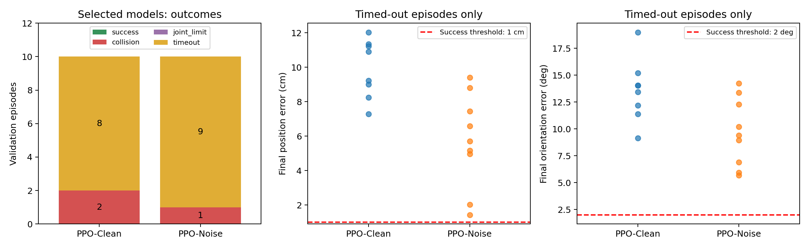

# PPO 动态任务失败诊断

使用冻结验证场景 40000–40009，共 120 个诊断回合。正式测试集评估保持暂停。
每组沿用对应训练噪声；确定性策略；奖励、1 cm/2° 成功条件均未修改。
延长回合、冻结障碍物、移除障碍物仅用于诊断，不计入正式基准结果。

## 1. 选中模型的直接失败类型

Clean 使用 85 万步选中模型，Noise 使用 95 万步选中模型。

| 模型 | 成功 | 碰撞 | 关节越界 | 超时 | 超时回合平均位置误差 | 超时回合平均姿态误差 |
|---|---:|---:|---:|---:|---:|---:|
| clean | 0 | 2 | 0 | 8 | 9.90 cm | 13.55° |
| noise | 0 | 1 | 0 | 9 | 5.72 cm | 9.66° |

碰撞均为墙板与障碍物碰撞：Clean 的 seed 40002、40006 在第 25 步碰撞；Noise 的 seed 40000 在第 2 步碰撞。
17 个超时回合的位置和姿态都没有同时达到成功阈值，而且各自均超过阈值。
Clean 超时位置误差 7.29–12.03 cm、姿态 9.13–18.99°；Noise 为 1.43–9.40 cm、5.69–14.24°。
“超时”是终止类型，“精度不足”是其表现，不能当作互斥的两类相加。
仅作描述时，以位置 <5 cm 且姿态 <10° 定义“较接近”：Clean 0/8、Noise 2/9 个超时回合符合；这不是放宽成功标准。

## 2. 对照诊断

| 噪声条件 | 检查点 | 场景 | 成功 | 碰撞 | 越界 | 超时 |
|---|---|---|---:|---:|---:|---:|
| clean | alignment_final | no_obstacles | 10 | 0 | 0 | 0 |
| clean | best | dynamic | 0 | 2 | 0 | 8 |
| clean | best | extended_dynamic | 0 | 3 | 0 | 7 |
| clean | best | frozen | 0 | 1 | 0 | 9 |
| clean | best | no_obstacles | 0 | 0 | 0 | 10 |
| clean | final | dynamic | 0 | 10 | 0 | 0 |
| noise | alignment_final | no_obstacles | 10 | 0 | 0 | 0 |
| noise | best | dynamic | 0 | 1 | 0 | 9 |
| noise | best | extended_dynamic | 0 | 2 | 0 | 8 |
| noise | best | frozen | 0 | 1 | 0 | 9 |
| noise | best | no_obstacles | 0 | 0 | 0 | 10 |
| noise | final | dynamic | 1 | 3 | 0 | 6 |

- `dynamic`：原始 240 步（12 秒）动态场景；`extended_dynamic`：720 步（36 秒）。延长后仍零成功，且两组各增加一次碰撞，不能简单归因于时间不够。
- `frozen`：相同初始布局，障碍物静止、速度观测为零；仍然零成功，动态运动不是唯一难点。
- `no_obstacles`：保留相同远距离初始关节和目标，清空障碍物、对应观测槽置零。20 万步 `alignment_final` 模型均 10/10 成功，后续 `best` 模型均 0/10。这支持后续避障训练遗忘了精确对准能力。
- 移除障碍物后，选中模型平均仍停在 Clean 5.37 cm/4.86°、Noise 3.47 cm/4.57°，说明误差不完全由避障造成。

## 3. 为什么奖励较高仍零成功

选中模型的动态验证平均奖励为 Clean 170.88、Noise 170.78。位置进展项平均贡献约 164.25、161.31，姿态进展项约 28.52、27.00，成功奖励贡献均为零。
从约 1.84 m 移动到目标附近已能积累大量进展奖励；进一步进入 1 cm/2° 区域才获得成功奖励。
这解释了回报与成功脱节，但仅凭本次诊断不能证明某个奖励权重就是唯一原因。

## 4. 最终模型与验证日志的差异

重新执行保存的最终权重：Clean 0 成功/10 碰撞；Noise 1 成功/3 碰撞/6 超时。
Noise 的 seed 40003 在第 193 步成功：位置误差约 9.32 mm、姿态误差约 1.83°；独立复查重现了该结果。
训练回调在收集 rollout 时验证，随后 PPO 还会更新参数。100 万步日志对应更新前模型，final_model.zip 对应更新后模型，因此不能将日志的 0/10 直接当作最终权重结果。
当前 best_model.zip 仍保留原有选择，不因本次诊断自动替换。未来应在参数更新后和最终保存后验证，并用同一版本权重做选择。

## 5. 后续优先项（尚未实施）

1. 修正验证时点，显式评估最终保存模型，避免遗漏更好的末轮策略。
2. 在避障训练中持续混入无障碍与近目标对准回合，监控对准回归，减少阶段切换造成的遗忘。
3. 先验证静态障碍物下的完整成功，再逐渐增加运动速度/范围；保留完整难度作为独立最终验证。
4. 检查末端位置/姿态精度及动作抖动，再设计终端误差奖励或精细控制实验；不要仅增加总训练步数。
这些修改需要另行确定实验方案。本次没有重新训练、改变正式成功标准或继续正式评估。

局限：仅 10 个已用于模型选择的验证场景、每组一个训练种子；诊断用于定位问题，不能证明普遍性能。

复现：`python scripts/diagnose_dynamic_policy.py`，然后 `python scripts/diagnose_dynamic_policy.py --followup`，最后 `python scripts/report_dynamic_diagnosis.py`。前两条分别创建/追加诊断数据，拒绝覆盖已有对应结果。

