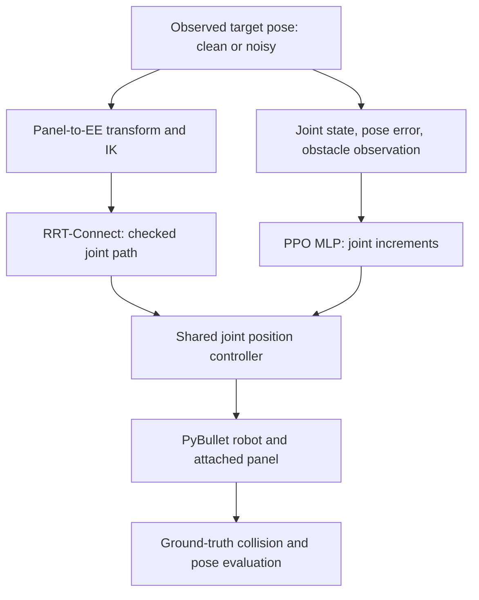

# Reinforcement Learning for Collision-Aware Robotic Wall Panel Installation

## Current corridor success rate (2026-11-06, v20)

On64 new valid scenes from the current14–22cm measured-route layout (O2 down5cm),
PPO+prediction+local recovery achieves43 successes,1 collision and20 timeouts:
**67.2% installation success**. Pure PPO on the identical64 initial states has
0 successes and64 collisions. Successful installation with the strict measured
vertical-passage diagnostic occurs in9/64 scenes (14.1%). The source model and
controller were frozen; no training or final-test evaluation was performed.
All20 enhanced-controller timeouts meet the waiting/stagnation diagnostic.
See the [full rate report](results/diagnostics/four_corridor_validation_v20_seed181/README.md),
[counts and rates](results/diagnostics/four_corridor_validation_v20_seed181/metrics.csv),
and [figure](results/diagnostics/four_corridor_validation_v20_seed181/success_rate.png).

## Larger height-stagger demonstration (2026-11-06, v19)

`demo_vertical_weave.py` now uses14–22cm alternating offsets along a preliminary
measured execution, preserving O2's5cm downward offset. After that translation,
enforce at least35cm total anchor-height span and14cm adjacent difference.
Motion stays18cm/0.12m/s. Source model/controller and240-step task limit stay
unchanged. A measured PPO+prediction+recovery example passes below O1, above O2,
then below O4 and succeeds in239 real steps. The new layout is harder: this is
a selected development demonstration, not the old98.4% validation result.
Old layout remains accessible through `demo_vertical_weave_v18.py`.
See [commands, full/excerpt replay and all trial outcomes](docs/VERTICAL_CORRIDOR_DEMO.md).

## Current vertical-layout validation (2026-11-06, frozen v18)

On64 new shared validation scenes with four moving boxes,8–14cm base height
offsets and O2 lowered5cm: PPO40success/23collision/1timeout;
RRT55/1/0 plus8 planning failures; PPO+prediction+local recovery63/0/1;
the precommitted50/50 RRT/enhanced-PPO mixture58/1/1 plus4 planning failures.
The mixture draws30 RRT and34 enhanced-PPO episodes and reuses matching full
rollouts. Source weights and controller parameters remain unchanged; no training
or final-test episodes. The remaining enhanced-PPO timeout is a reference/recovery
stagnation case, not a near-goal accuracy failure. Frozen model/configuration,
paired CSVs and [full diagnosis](results/diagnostics/four_vertical_validation_v18_seed161/README.md)
are available with the [comparison figure](results/diagnostics/four_vertical_validation_v18_seed161/comparison.png).

## Smooth recorded playback (2026-11-06)

Demo entry points now first complete the physical episode headlessly, save its
actual states, and then replay at a target60 FPS /0.6x speed. Prediction and
recovery searches finish before the GUI opens. The original success/collision
result and actual waiting/reversing remain intact; interpolation is display-only.
Replay an already recorded four-dynamic case (O2 lowered5cm) without model loading:

```bash
env -u PYTHONPATH /home/johnsonchen/wall-panel-rl/.conda-env/bin/python scripts/replay_episode.py results/replays/vertical_1144004.json
```

Normal demo commands automatically use this workflow. `--headless` records only;
`--trajectory-output PATH` chooses the recording file; `--playback-mode live`
restores computation during live display. See [record/play commands](docs/RECORDED_PLAYBACK.md)
and [verification](results/diagnostics/recorded_playback_v17/README.md).

## Larger/faster dynamic demo (2026-11-05, inference only)

`scripts/demo_four_dynamic_faster.py` now uses the selected v9 fast02 model with
15cm maximum anchor displacement and0.10m/s maximum vector speed. The previous
10cm/0.05m/s profile is saved separately; original5cm/0.02m/s is also retained.
Four unequal boxes move smoothly inXYZ with fresh random scenes
and phases. Keep the original slow profile and training banks unchanged.
No training is launched. Fresh-scene screening can be slower under the larger
motion bounds; endpoint/wall/spacing guards remain in place.
Current15cm/0.10m/s functional check:4success/3collision/1timeout over8 scenes,
with motion bounds and unchanged model verified; this is not a rate estimate.
See [command/settings](docs/ENHANCED_DYNAMIC_DEMO.md),
[motion configuration](configs/four_dynamic_faster.yaml) and
[report](results/diagnostics/four_dynamic_faster_preflight_v2_seed61/README.md).

## Paired speed continuation (2026-11-05, completed;90% dynamic)

User confirms90% dynamic /10% static new training episodes. Continue both arms
from the same selected v8+2k model and matched PPO/BC optimizer, pool and RNG
states. Each adds2k PPO transitions: fixed0.01 versus0.02m/s. Keep50/50 RRT/PPO
ownership and evaluate both at0.02m/s with the same64 cases and static guards.
Do not reevaluate the used100-case test. These are two separate continuations,
not4k additional steps applied consecutively to one model.

Both arms complete2k new PPO transitions and select their final checkpoints.
At0.02m/s target validation, both improve43/18/3 to47/15/2 out of64.
Original-static stays57/7/0. The fixed mixture improves51/11/2 to53/10/1
(train0.01) or54/9/1(train0.02). Pure scores tie; different outcomes on two
PPO target cases explain the one-case mixed difference. No used independent
test is reevaluated. This is one paired seed, not a general speed ranking.

See [protocol and commands](docs/DYNAMIC_SPEED_COMPARISON.md),
[comparison settings](configs/four_dynamic_speed_comparison.yaml) and
[report](results/diagnostics/four_dynamic_speed_comparison_v9_seed71/README.md),
[curves](results/diagnostics/four_dynamic_speed_comparison_v9_seed71/curves.png) and
[checkpoint counts](results/diagnostics/four_dynamic_speed_comparison_v9_seed71/checkpoints.csv).

## Conservative dynamic PPO adaptation (2026-11-05, completed)

Connect the slow-dynamic environment to a separate v5 continuation:5k PPO
transitions,LR3e-6,50/50 RRT/PPO episode owners and30% static retention scenes.
Gate speed progression0.005->0.01->0.02m/s on fixed validation, with5cm motion
bounds. Keep low-strength auxiliary BC; dynamic teachers require timed schedule
checks, successful execution and matching fresh physics replay. PPO likelihoods
and expert labels remain separate. Freeze192 train/64 validation/100 reserved
test cases; the test is used once only if a new checkpoint is selected.

Complete5k; select the+2k checkpoint. Pure-PPO target-speed validation improves
41/20/3 to43/18/3(success/collision/timeout), original-static56/8/0 to57/7/0.
The selected mixture stays51/11/2. New100-case dynamic paired test improves
77/22/1 to79/20/1: four collisions rescued, two old successes lost. This is a
small single-seed improvement. The final5k candidate regresses to39/21/4 and
is not selected. Source/default weights remain preserved; new checkpoints are
separate. All28 targeted checks and the real teacher/data probe pass. See
[protocol and commands](docs/FOUR_DYNAMIC_TRAINING.md),
[settings](configs/four_dynamic_ppo.yaml) and
[report](results/diagnostics/four_dynamic_ppo_v8_seed61/README.md),
[curves](results/diagnostics/four_dynamic_ppo_v8_seed61/curves.png) and
[checkpoint counts](results/diagnostics/four_dynamic_ppo_v8_seed61/checkpoints.csv).

## Four slowly moving obstacles (2026-11-05, v5 inference only)

New `scripts/demo_four_slow_dynamic.py` uses v5 with50% RRT /50% PPO ownership
per episode. Four different-size obstacles move smoothly in three dimensions
around randomized on-path anchors. Maximum anchor offset5cm, maximum vector
speed0.02m/s; fresh robot/layout/phase randomization, zero noise,0.6x playback.
RRT uses time-dependent collision checks, allowing safe traversal through swept
regions, while planning pauses simulation time. No model training is started.

Eight-case functional check: RRT2success; PPO5success/1collision. Every obstacle
moves in XYZ within the bounds; source weights/update counters stay unchanged.
This small check is not an independent success-rate estimate.
See [commands and motion settings](docs/FOUR_SLOW_DYNAMIC.md),
[configuration](configs/four_slow_dynamic.yaml) and
[functional report](results/diagnostics/four_slow_dynamic_preflight_v1_seed61/README.md).

## Online-BC ablation completed (2026-11-05, source retained)

Replay the six lost validation successes: three panel/obstacle4 collisions and
three traversal timeouts, with unchanged original reference arrays but stalled
reference advancement. Run a separate5k continuation from the same PPOv5 source,
disabling only online BC updates and keeping50/50 RRT/PPO episode routing.
The same5,438 verified expert observation/action pairs are collected in both
runs, but the ablation performs zero auxiliary updates versus five at the
matched BC-on5k checkpoint. The source optimizer/value state, seed, case bank,
PPO settings and evaluation assignments are verified identical.

At5k, BC-on pure-PPO validation is55 success/8 collision/1 timeout; BC-off is
50/11/3. Mixture totals are60/4/0 versus55/7/2. Turning off BC does not improve
this single-seed validation result. Keep the original PPOv5 model; no new
independent test or automatic promotion. The5k ablation has5,438 extra RRT
transitions and10,438 total physical transitions. Complete82 RRT successes and
79 PPO episodes(30 success/44 collision/5 timeout); four PPO episodes unfinished.
All19 targeted interface/continuation/imitation checks pass.

See [matched comparison](results/diagnostics/four_mix_ablation_v7_seed61/README.md),
[curves](results/diagnostics/four_mix_ablation_v7_seed61/curves.png),
[paired cases](results/diagnostics/four_mix_ablation_v7_seed61/paired_cases.csv),
[regression diagnosis](results/diagnostics/four_mix_regression_v7_seed61/README.md)
and [ablation settings](configs/four_episode_mix_nobc.yaml).

## Formal50/50 mixture finished (2026-11-04, no update adopted)

Complete10k PPO+10,131 RRT transitions,20,131 total physics transitions. Finish
149 RRT episodes(all successful)and141 PPO episodes(57 success/73 collision/11
timeout),with4 PPO episodes unfinished. Ten auxiliary BC updates pass the KL
guard. The original source checkpoint remains selected:all policy tensors are
identical to PPOv5. Pure-PPO validation regresses56/64 to50/64,and the fixed
episode mixture regresses60/64 to55/64. Keep the original weights; do not adopt
the final candidate. Mixed93.75% validation was already present before training
and is not a new learned improvement or independent-test result. Process exited.
See [final report](results/diagnostics/four_episode_mix_v6_seed61/README.md),
[curves](results/diagnostics/four_episode_mix_v6_seed61/curves.png)and
[checkpoint counts](results/diagnostics/four_episode_mix_v6_seed61/checkpoints.csv).

## Four-static RRT/PPO episode mixture interface (2026-11-04)

Add a separate50/50 episode router for training and evaluation,starting from the
selected84% PPOv5 candidate. The expert is the existing RRT-Connect,not a BC
network. One controller owns each episode. PPO retains its own on-policy
transitions/log probabilities; only verified successful RRT episodes supply a
separate,KL-bounded auxiliary BC loss at rollout boundaries. Expert physics and
episode counts are logged separately from the configured10k PPO-step budget.

At interface installation, no formal mixture training had started and source
weights remained unchanged. Eight-episode functional preflight
draws2 RRT(2 success)and6 PPO(4 success/2 collision). A separate training-wrapper
probe delivers56 verified expert pairs,then a successful PPO episode. This is
not a new independent success-rate estimate. Mixture evaluation logs RRT/PPO
subscores and total separately; pure-PPO validation selects learned checkpoints.
Full188 regression tests and6 final entry checks passed at that stage. The
subsequent completed formal run is reported above; the source stays selected.
See [design and complete commands](docs/FOUR_EPISODE_MIX.md),
[configuration](configs/four_episode_mix.yaml)and
[preflight report](results/diagnostics/four_episode_mix_preflight_v6_seed61/README.md).

## Expanded four-static PPO completed (2026-11-04)

Replay remaining13 collisions:panel/slot4 in11 late cases and panel/slot3 in2
early cases. Freeze192 train (64 old+128 new),64 fresh validation and100 fresh
test layouts; old32/64 banks stay separate for regression. Continue20k PPO with
original Adam/value state preserved and25% hard-TRAIN sampling. Select the+10k
checkpoint:64-validation56 success/8 collision/0 timeout versus source51/13/0.
The final+20k candidate regresses to46/11/7 and is not selected.

Fresh100 paired test improves74% to84% success,25 to16 collisions,1 to0 timeout.
All74 source successes stay successful. Old64 regression improves51 to55
successes. With5mm/0.5deg target-observation noise, selected success stays84/100;
sampled actions yield57 success/35 collision/8 timeout. These are distinct
conditions on the same100 layouts.84% remains below the proposed90% target.
Full182 tests pass. No dynamic-obstacle stage, BC update or online RRT fallback.

See [current report](results/diagnostics/four_expanded_ppo_v5_seed61/README.md),
[curves](results/diagnostics/four_expanded_ppo_v5_seed61/curves.png),
[checkpoint counts](results/diagnostics/four_expanded_ppo_v5_seed61/checkpoints.csv),
[collision/data report](results/diagnostics/four_expanded_v5_seed61/README.md)
and [design/commands](docs/FOUR_EXPANDED_PPO.md). Show this model with
`python scripts/demo_four_expanded.py` (fresh random scene,0.6x playback).
Previous models, reports and explicit demo entries are preserved.

## Four-obstacle priority: PPO improvement (2026-11-04)

Prioritize four-static success; two-obstacle retention no longer gates selection.
BC-only continuation and training-layout corrections do not improve the source,
so retain BC1,000 and adapt it with10,000 pure PPO transitions. No online RRT
episodes or auxiliary imitation updates enter PPO. Physical scene difficulty,
collision/installation criteria and240-step horizon are unchanged.

Validation improves17/32 to22/32. On the once-reserved64-scene paired test,
success rises37/64 (57.8%) to51/64 (79.7%); collisions fall27 to13, with no timeouts.
All37 original successes are retained;14 collisions become successes. These are
deterministic, noise-free policy results. Stochastic training has37 success/132
collision/14 timeout completed episodes, and is reported separately. The test
bank is now used; later tuning needs new scenes for another independent test.

See [current PPO report](results/diagnostics/four_priority_ppo_v4_seed61/README.md),
[curves](results/diagnostics/four_priority_ppo_v4_seed61/curves.png),
[checkpoint counts](results/diagnostics/four_priority_ppo_v4_seed61/checkpoints.csv)
and [training design/negative experiments](docs/FOUR_PRIORITY_TRAINING.md).
Watch the trained policy with `python scripts/demo_four_trained.py` (fresh random
four-static scene,0.6x playback). The old demo_four_static.py still uses the
initialized source. Original files and reports remain available.
Full178 regression tests pass. Fixed and fresh-random headless trained-policy
demos both install successfully; those demonstrations are not rate estimates.

## Four-static BC pilot completed (2026-11-04)

Run1,000 actor-only BC updates from the unchanged initialization, using64 new
verified layouts and20% frozen-policy retention replay. On32 new validation
scenes, initialization is4 success/28 collision; BC1,000 reaches17/15, but old
two-static success drops15/20 to8/20. Select BC25 under the retention rule:
four-static7/32 (25 collisions), old two-static16/20. One-static/alignment
trajectories, frozen base/critic/std and original source file remain unchanged.
No PPO is started; the selected candidate fails the short-PPO readiness check.
The64 new test layouts remain reserved and the default animation is unchanged.
14 interface and compatibility tests pass. Shared multi-obstacle correction
interferes with earlier two-box behavior; an independent four-box branch is the
next suggested experiment.

See [BC report](results/diagnostics/four_obstacle_bc_v1_seed61/README.md),
[learning/validation curves](results/diagnostics/four_obstacle_bc_v1_seed61/curves.png),
[checkpoint counts](results/diagnostics/four_obstacle_bc_v1_seed61/checkpoints.csv)
and [design/commands](docs/FOUR_OBSTACLE_BC.md).

## Four-box teacher package completed (2026-11-04, no training)

Freeze independent64 training/32 validation/64 test scenes with four static
blockers on nominal motion. Collect64 physically successful, pre/post-verified
RRT demonstrations (3,973 transitions;64 attempts, no retries), using10mm
planning clearance. The old99-scene regression remains separate at5mm. Three
scene-generation candidates time out without obstacles and are listed separately.
Validation/test four-box episodes have not been executed or used for labels.

Resume after52 demonstrations without regenerating scenes. Archive the original
files and verify every saved array prefix exactly matches. Three original and
three resumed episodes physically replay with maximum error0. The77-observation,
7-action dataset is complete; a later BC interface must explicitly support its
four_static task and retention of earlier skills. BC/PPO updates remain0 and
the default demo still uses the initialized policy.
See [data report](results/diagnostics/four_safe_teacher_v1_seed61/README.md),
[demonstration overview](results/diagnostics/four_safe_teacher_v1_seed61/overview.png)
and [quality audit](results/diagnostics/four_safe_teacher_v1_seed61/verification.json).

## Verified static RRT regression (2026-11-04, no training)

Static RRT now checks original and refined0.005-radian samples over execution
waypoints, including shortcuts and the final route. Unsafe candidates continue
searching; the controller independently rejects an invalid dense path. The same
99-scene regression improves from97 successes/2 collisions to99 successes/0
collisions, with no timeouts or planning failures. All found routes pass both
pre-execution and post-execution checks. These finite samples do not certify
continuous collision safety. The5mm planning clearance, physical collision
threshold, actuator, initialized policy weights and default demo are unchanged.
Full166 tests pass. No BC/PPO optimization has been performed.

See [verified regression report](results/diagnostics/four_on_path_rrt_verified_v2_seed61/README.md),
[before/after comparison](results/diagnostics/four_on_path_rrt_verified_v2_seed61/overview.png)
and [verification/data design](docs/VERIFIED_FOUR_RRT.md).

## Four-on-path RRT execution validation (2026-11-04, no training)

The fixed99-scene comparison reproduces initialization24 successes/75 collisions.
Unchanged RRT-Connect finds paths in99/99 and physically succeeds97/99, with2
payload/box collisions and no timeouts or planning failures. Each failed scene
gets two separately reported planner-seed retries; all4 retries succeed. Every
scene therefore has an actual executable-solution witness, while the primary
RRT score remains97/99. Source policy weights and scene bank are unchanged.

All75 policy collisions involve the panel: dominant obstacle3 in47 cases,
obstacle4 in27, obstacle2 in1. RRT failures are panel collisions at steps9/45.
Four primary plans fail sampled post-execution5mm-clearance recheck, including
two physically successful routes. The collision-route witnesses have only
1.12mm/2.27mm clearance; sampled physical penetration is not established.
Refine path verification before using all successful paths as training labels.
Full161 tests pass. The default animation remains the initialized policy.
See [full baseline report](results/diagnostics/four_on_path_rrt_validation_v1_seed61/README.md),
[comparison](results/diagnostics/four_on_path_rrt_validation_v1_seed61/overview.png)
and [per-collision details](results/diagnostics/four_on_path_rrt_validation_v1_seed61/collisions.csv).

## Current demo: four static blockers on nominal initialization motion (2026-11-03)

The same `python scripts/demo_four_static.py` command now places boxes on the
initialized policy's actual obstacle-free simulated motion. Four separate
contact witnesses verify intersections with the arm/payload, around20/40/60/80%
of the path. Endpoint poses remain valid and box gaps are at least0.1m. Cyan is
the obstacle-free nominal trajectory; blue is actual execution with obstacles.
Placement occurs before rendering. Starts/layouts stay random; --seed reproduces
a scene. Same source weights, four STATIC boxes,0.6x playback, no retraining.

On99 valid paired scenes, previous positions yield81 successes/11 collisions/7
timeouts; on-motion positions yield24/75/0. One of100 attempted scenes cannot
produce a complete obstacle-free nominal route (timeout), and is listed separately.
The earlier82% applies only to the previous positions. Full158 tests pass.
See [current report](results/diagnostics/four_static_on_path_v1_seed61/README.md),
[3D placement preview](results/diagnostics/four_static_on_path_v1_seed61/placement_preview.png)
and [placement settings](configs/four_static_on_path.yaml).

## Previous four-static initialization placement (2026-11-03)

The previous profile used `demo_four_static.py` (or `demo_autonomous_ppo.py`) for the
initialized policy with four sparse static boxes. Each run generates a fresh
random start/obstacle layout; `--seed 20261103` reproduces one layout. Playback
is0.6x. Source model weights are byte-identical; no BC/PPO training is performed.
The77-input/7-action interface retains five obstacle slots, one empty.

Same100-scene count-only regression: two boxes87 successes/6 collisions/7
timeouts; four boxes82/11/7. These are already-seen underlying scenes, not a new
independent test. Added-slot weights and the independent correction output are
still zero, so do not describe this as a newly learned four-box avoidance policy.
All156 tests pass; deterministic/fresh-random headless demos are verified.
See [four-box report](results/diagnostics/four_static_initial_v1_seed61/README.md),
[comparison](results/diagnostics/four_static_initial_v1_seed61/overview.png) and
[profile](configs/four_static_initial.yaml). Earlier model files and explicit
two-static demo entry points are preserved.

## Coverage and route-consistency BC completed (2026-11-03, no update adopted)

See [design and commands](docs/CONSISTENT_TWO_STATIC.md),
[complete results](results/diagnostics/consistent_two_static_v4_seed61/README.md)
and [curves](results/diagnostics/consistent_two_static_v4_seed61/overview.png).
Add128 training layouts and freeze separate64-layout validation/100-layout test
banks. Audit182 training layouts using three RRT seeds each; select one route
per layout. Collect182 full demonstrations and99 successful correction suffixes
covering44 failure layouts. The final dataset has419 episodes/17,805 states.
Reject unsafe candidates before label collection; preserve the interrupted
collection archive and resume its80-layout checkpoint with exact array equality.

Complete3,000 BC updates. Raw final validation drops from58/64 success,3
collisions to21/64 success,43 collisions; legacy20 drops15/4/1 to6/14/0.
Retain initialization (BC0); the learned-gain gate fails, so PPO is NOT started.
The retained initialization scores87/100 success,6 collisions,7 timeouts on the
new test, unchanged before/after. This is not a training gain. One-static known
regression remains95/2/3 with identical trajectories. Full153 tests pass.
Original default and all previous models stay unchanged; no dynamic stage.

## Independent two-static adapter completed (2026-11-03, not adopted)

See the [design and commands](docs/TWO_STATIC_ADAPTER.md),
[full report](results/diagnostics/two_static_adapter_v3_seed61/README.md) and
[curves](results/diagnostics/two_static_adapter_v3_seed61/overview.png).
A separate multi-obstacle correction network preserves the original actor and
learns a response to the second box. Add 37 targeted successful RRT trajectories
(293 demonstrations / 14,162 states total), then run 3,000 BC updates and a 10k
PPO pilot. Select BC update250; neither PPO checkpoint improves upon it.
Fixed20 validation stays15 successes, while collisions fall4->2 and timeouts
rise1->3. On a NEW paired100-scene test, initialization scores87/8/5
(success/collision/timeout) and the learned candidate76/14/10. This is a
generalization regression, not a success-rate improvement. Known one-static
regression remains95/2/3 with identical trajectories. All147 tests pass.
Do not adopt the candidate, extend its training budget or start dynamic motion.
The default one-static model and all previous two-static checkpoints are kept.
An explicitly diagnostic demo is `python scripts/demo_two_static_adapter.py`.

## Protected two-static correction completed (2026-11-02)

See [initialization/protection design and full outcomes](docs/PROTECTED_TWO_STATIC.md).
The first strengthened BC trial forgets one-static skill and is not adopted.
Zero-initialize previously inactive obstacle input columns, then protect the
entire original one-static actor while learning only added-slot connections.
Two-static validation improves from0/20 to15/20 without training; one-static
remains18/20. Complete a separate2,500-update BC pilot and10k PPO continuation.
Neither update beats initialization; selected BC/PPO additional step is0.

The selected candidate scores85/100 on new two-static scenes (10 collisions,
5 timeouts), exactly matching initialization-only. One-static known regression
stays95/100,2 collisions,3 timeouts. New-slot action weights remain zero in the
selected model, so85% is not evidence of newly learned second-obstacle avoidance.
Known validation is still75%; release gate fails and the original default stays.
Full143-test regression passes. [Protected v2 report](results/diagnostics/protected_two_static_v2_seed61/README.md)
and [curves](results/diagnostics/protected_two_static_v2_seed61/overview.png).

`python scripts/demo_two_static.py --controller ppo` explicitly shows the new
two-static diagnostic candidate. The original default demo remains one-static.

## Static expansion completed (2026-11-02)

The [static expansion study](docs/STATIC_EXPANSION.md) verifies the retained
one-static model on 100 new scenes: 95 successes, two collisions, three timeouts.
Increasing to three sparse static boxes gives zero PPO successes on 20 validation
targets, before and after a bounded 10k adaptation (5k: 14 collisions / 6 timeouts;
10k: 20 collisions). RRT solves all 20 validation targets. No three-static PPO
checkpoint passes the gate; preserve the original one-static default model and
defer moving obstacles. The retained diagnostic source also fails all 100 held-out
three-static targets. It has not learned a three-static policy.

See [overall results](results/diagnostics/static_expansion_v1_seed61/README.md),
[comparison](results/diagnostics/static_expansion_v1_seed61/overview.png) and
[training curve](results/diagnostics/static_three_rrt_ppo_v1_seed61/overview.png).
Training logs' 23 PPO successes are all obstacle-free alignment, not three-box
avoidance. This run finishes exactly 10k PPO + 5,080 RRT transitions; no extra
budget or dynamic stage is started.

## Latest local update: episode-level RRT/PPO (2026-11-02)

See [episode mixture design and commands](docs/EPISODE_RRT_PPO.md). Training and
evaluation can select RRT or PPO once per episode with probability 0.5 each.
Successful RRT episodes supply a separate BC actor loss; PPO's rollout buffer
contains only its own on-policy samples. The first mixed training has completed:
10,000 PPO transitions plus 7,030 RRT transitions, ten accepted BC updates.

Following the professor's collision-first preference, retain the 5k checkpoint:
18/20 validation successes, zero observed collisions, two timeouts, versus the
17/20, zero-collision, three-timeout starting actor. The final 10k candidate is
18/20 with one collision and one timeout, so it is not selected. The retained
model's mixture result is 19/20, zero collisions and one timeout; RRT is 20/20.
All are known validation results. Historical 282/300 regression belongs to an
earlier model; the new checkpoint has not received that 300-scene evaluation.
See [completed training report](results/diagnostics/episode_rrt_ppo_v1_seed61/README.md)
and [curves](results/diagnostics/episode_rrt_ppo_v1_seed61/overview.png).

`python scripts/demo_episode_mixture.py` randomly selects one controller for an
entire demo; `python scripts/demo_autonomous_ppo.py` remains pure PPO.
`python scripts/train_episode_rrt_ppo.py` checks inputs only. Explicit `--train`
starts learning; `--evaluate` runs the separate controller comparison.

## Current snapshot: conditional recovery PPO (2026-10-30)

This version is published separately on `release/conditional-recovery-ppo-20261030`.
The existing `main` and earlier model branches are preserved. Start with
[this snapshot guide](docs/GITHUB_SNAPSHOT_20261030.md), the
[latest results](results/diagnostics/conditional_ppo_adaptation_v3_seed61/README.md)
and [checkpoint curve](results/diagnostics/conditional_ppo_adaptation_v3_seed61/overview.png).
The later sections retain the project's earlier experiments and configurations.

Current method: 77 observation features, seven joint-increment actions, a frozen
BC tracking prior with a PPO residual, and bounded stagnation-triggered reference
recovery. Current validation covers one static obstacle with zero sensing noise.
The retained conditional controller scores 18/20 validation success and 282/300
on already-seen regression scenes. These are separate evaluation groups, and the
300-case result is not a fresh independent test. An additional 10k PPO run scored
16/20 at 5k and 17/20 at 10k; neither update replaced the retained source weights.

After installing the environment below, run from the repository root:

```bash
python scripts/demo_autonomous_ppo.py --seed 1000000 --playback-speed 0.6
# Inference-only verification without a GUI:
python scripts/demo_autonomous_ppo.py --headless --seed 1000000
```

The demo loads the included model and matching conditional manifest using the
repository path. No online RRT avoidance route or training is launched. The
latest adaptation config also uses repository-relative paths; archived experiment
records retain original paths for provenance. See the snapshot guide before
rerunning historical studies.

Can a PPO joint-space policy learn collision-aware panel manipulation and maintain
accurate alignment under target measurement noise, compared with sampling-based
planning and feedback control?

This repository contains a runnable PyBullet/Gymnasium environment, SB3 PPO
training, a project-implemented bidirectional RRT-Connect, fixed-seed evaluation,
CSV summaries, plots and graphical demos. The seven-joint KUKA iiwa holds a
0.30 × 0.20 × 0.03 m rigid panel. Success requires <1 cm position error and <2°
orientation error, without collision. There is **no observation delay**.

## Install

From this repository root:

```bash
conda env create -f environment.yml
conda activate wall-panel-rl
# If your shell previously sourced ROS, clear its unrelated Python plugins:
unset PYTHONPATH
python scripts/smoke_test.py
pytest -q
```

Python and direct library versions in `environment.yml` are the actual tested
versions. CPU PyTorch is pinned; no CUDA or GPU is required. A pip alternative
using Python 3.11.5 is:

```bash
python -m venv .venv
source .venv/bin/activate
python -m pip install -r requirements.txt
python scripts/smoke_test.py
python -m pytest -q
```

Scripts add `src/` to their import path; an editable install is unnecessary.
Run commands from the repository root. The smoke test verifies stages A/B/C,
SB3's API checker, IK, RRT and physical installation. No full training occurs.

## Methods and configuration

The original static PPO uses a 41-element observation with normalized q (7), dq (7), relative target
position (3), relative rotation vector (3), and three obstacle slots (7 each:
relative center, dimensions, presence). Missing slots are zero. A two-layer
128-unit ReLU MLP outputs seven normalized increments. Each action produces
`q_des = clip(q + action * radians(4), joint_limits)`. Attempted limit violations
are penalized and terminate; clipping does not silently hide them.

The current dynamic retraining uses 70 observations with five obstacle velocity
slots; see [Dynamic PPO retraining](#dynamic-ppo-retraining-with-70-observations).
Models must be paired with a configuration having the same observation shape.

Both methods execute using the same Bullet joint position controller, 240 Hz
physics and 12 physics steps per high-level decision. The panel is attached by a
fixed constraint. Collisions include robot/panel versus obstacles and wall,
nonadjacent self-collision, and panel versus non-gripped links.

The reward is

```text
100 * (previous_position_error - position_error)
+ 12 * (previous_orientation_error - orientation_error)
- 0.015 * sum(action**2) - 0.05
- 50 * collision - 30 * joint_limit_violation + 100 * success
```

Orientation errors in the reward are radians. Terminal events use ground truth.
The controller observation alone has target measurement noise: independently
sampled Gaussian translation (5 mm per axis) and rotation-vector (0.5° per axis).
The clean condition uses zero noise. Joint state and obstacle geometry are exact.

RRT takes the **same first noisy target observation**, converts panel pose to
end-effector pose, solves multistart IK, then grows and connects two joint-space
trees. Edges are checked every 0.035 rad; configurations have a 5 mm planning
clearance. It follows the resulting waypoints through the common controller.
It plans once, rather than updating its target after every observation. PPO gets
fresh target observations each step. This experimental distinction is deliberate
and documented in `DECISIONS.md`; neither receives a secretly perfect target.
A noisy planned goal can lie outside the true success tolerance.



All parameters are in `configs/base.yaml`; other YAMLs inherit and override it.
Stages: A = no boxes; B = one fixed sparse box; C = 1–3 randomized sparse boxes.
Start/goal overlap is rejected. Sparse sampling does not mathematically guarantee
a connecting path. Failures stay in the reported denominator.

## Training

Each run requires a unique name and saves resolved config, provenance, Monitor
CSV, TensorBoard logs, periodic checkpoints, best evaluation model and final model.
No VecNormalize is used. SB3 rounds timesteps up to complete rollout buffers.

```bash
python scripts/train_ppo.py --config configs/base.yaml \
  --total-timesteps 50000 --run-name my_phase1 --seed 42
python scripts/train_ppo.py --config configs/phase1_alignment.yaml \
  --resume models/my_phase1/final_model.zip \
  --total-timesteps 30000 --run-name my_alignment --seed 42
python scripts/train_ppo.py --config configs/base.yaml \
  --resume models/my_alignment/final_model.zip \
  --total-timesteps 50000 --run-name my_restored --seed 42
python scripts/train_ppo.py --config configs/stage_b_curriculum.yaml \
  --resume models/my_restored/final_model.zip --zero-obstacle-inputs \
  --total-timesteps 30000 --run-name my_phase2 --seed 42
python scripts/train_ppo.py --config configs/train_clean.yaml \
  --resume models/my_phase2/final_model.zip \
  --total-timesteps 100000 --run-name my_clean --seed 42
python scripts/train_ppo.py --config configs/train_noise.yaml \
  --resume models/my_phase2/final_model.zip \
  --total-timesteps 100000 --run-name my_noise --seed 42
```

The alignment run uses nearby initial states. Obstacle training mixes 25% nearby
and 75% original starts to retain precision learning; evaluation always disables
this mixture. The measured unsuccessful earlier attempts are retained separately. The one-time
`--zero-obstacle-inputs` transfer flag clears weights on features that were always
zero in Stage A, preserving the learned policy when obstacle slots become active.
Those weights remain trainable; do not apply this flag to the final branches.

Both final variants should branch from the same no-noise curriculum checkpoint
with equal additional budgets. Inspect learning first; these commands alone do
not guarantee convergence. `--device cpu` is the default; `--render` enables GUI.
`tensorboard --logdir models` displays training and reward-component logs.

## Evaluation and plots

The primary comparison uses each run’s best callback-validation checkpoint,
selected by mean return before the fixed benchmark is run. Final checkpoints
are also retained. Use the supplied models, or substitute paths to your own:

```bash
python scripts/evaluate.py --config configs/eval_clean.yaml \
  --clean-model models/ppo_clean/best/best_model.zip \
  --noise-model models/ppo_noise/best/best_model.zip --run-id my_eval_clean
python scripts/evaluate.py --config configs/eval_noise.yaml \
  --clean-model models/ppo_clean/best/best_model.zip \
  --noise-model models/ppo_noise/best/best_model.zip --run-id my_eval_noise
python scripts/plot_results.py --inputs \
  results/raw/my_eval_clean/episodes.csv results/raw/my_eval_noise/episodes.csv
```

Each command defaults to 100 scenarios (seeds 10000–10099) per method, with noise
seeds offset by 1,000,000. Scene and noise RNGs are separate. The script asserts
that all methods received identical initial configurations, obstacles and targets,
and saves these in `scenarios.json`. `--episodes N` changes the count; `--methods
rrt` evaluates only the planner. Run IDs cannot overwrite existing raw results.

Alternatively, `python scripts/benchmark.py --prefix my_benchmark` runs both
conditions and plots all six cells. Final metrics always use true simulated poses.
Continuous metrics include mean, sample standard deviation and count. Planning
and IK fields for PPO are intentionally missing. Wall-clock timings depend on
hardware and concurrent load; path lengths are summed at physics substeps.

`python scripts/verify_detour.py` demonstrates a real robot case in which the
straight joint path is blocked and RRT executes an alternative. This diagnostic
is distinct from the sparse random benchmark, where many direct paths are valid.

## Graphical demo

```bash
python scripts/demo.py --method rrt
python scripts/demo.py --method ppo --model models/ppo_clean/best/best_model.zip
python scripts/demo.py --method ppo --model models/ppo_noise/best/best_model.zip \
  --config configs/eval_noise.yaml
```

The GUI shows the robot, orange panel, green target, red obstacles, grey wall and
blue trajectory; the console prints errors, collision and success each step.
Seed 10002 is the default, selected as a successful demonstration scene; the
benchmark retains all 100 seeds and its failures. The window closes after the episode plus five seconds;
change `--hold-seconds` as needed. Each run also saves a rendered snapshot.

On the development Linux host, Conda's C++ runtime conflicted with Mesa. This
verified workaround selects the system runtime:

```bash
LIBGL_ALWAYS_SOFTWARE=1 LD_PRELOAD=/usr/lib/x86_64-linux-gnu/libstdc++.so.6 \
  python scripts/demo.py --method rrt
```

This path is Linux-specific; do not use it on macOS/Windows. A display-free image
can be generated with `python scripts/demo.py --method rrt --headless`.

## Repository guide

```text
assets/                   Local KUKA model, meshes and attribution
configs/                  Inherited YAML configuration and curricula
src/wall_panel_rl/envs/    Gymnasium environment, noise, geometry, collision
src/wall_panel_rl/control/ Shared physical joint actuator
src/wall_panel_rl/planning/IK and transparent RRT-Connect implementation
src/wall_panel_rl/baselines/Classical trajectory controller
src/wall_panel_rl/rl/      Reward-component callback
src/wall_panel_rl/utils/   Configuration and comparable rollout metrics
scripts/                  Smoke, training, evaluation, benchmark, plots, demo
tests/                    API, collision, reward, noise, limits and detour tests
models/                   Saved policies, resolved configurations, learning logs
results/raw/              Episode CSVs, scenarios, representative trajectories
results/summary/          Aggregated measured metrics
results/figures/          Learning, comparison and trajectory plots, screenshots
```

`REPORT_DRAFT.md` contains the scientific report and measured results;
`DEVELOPMENT_SUMMARY.md` records the completed runs and acceptance checks;
`DECISIONS.md` explains design choices and deviations;
`PROJECT_SPECIFICATION.md` preserves the supplied requirements. Regenerate the
report from the primary CSVs with `python scripts/write_report.py`.
`requirements-lock.txt` additionally pins transitive packages from the isolated
Conda install (use the CPU wheel index from `requirements.txt` when installing it).

## Reproducibility and external work

Python, NumPy, PyTorch, Gymnasium, SB3 and scenario RNGs are seeded. Training is
single-seed CPU evidence, not a multi-seed statistical study. Timeout-bounded RRT
and floating-point physics can vary with platform/load. Saved scenario records
and configs make the experiment inspectable; they do not promise bitwise replay
across machines. Repeat training with multiple seeds before drawing broad claims.

External software: PyBullet supplies physics, FK, IK, low-level motors and the
KUKA model; Gymnasium supplies the environment API; Stable-Baselines3 implements
PPO; PyTorch supplies neural networks; NumPy/SciPy provide numerical/quaternion
operations; Pandas/Matplotlib handle results; PyYAML and TensorBoard support
configuration/logging. The environment, RRT tree growth/connection/smoothing and
experiment scripts are implemented in this repository. See `assets/README.md`
for source and preserved robot license. This is simulation-only, with a rigid
small panel, simplified sensing, sparse boxes and no communication/control delay.
Joint-space actions **do not automatically guarantee collision avoidance**.

## Farther start and exactly three random obstacles

The two additional configurations preserve the original benchmark and models:

- `configs/far_start.yaml`: farther starts, no obstacles. The panel's actual FK
  distance to target must be between 1.80 and 1.90 m; joint offsets alone are not
  used as a distance guarantee.
- `configs/far_three_obstacles.yaml`: the same farther starts and exactly three
  boxes with randomized centers. Box sizes are 0.08 × 0.08 × 0.10 m, 0.12 × 0.10 × 0.16 m, and
  0.16 × 0.14 × 0.20 m. Centers are
  drawn around (0.50, 0.38, 0.48) m with per-axis ranges ±(0.35, 0.48, 0.26) m.
  Samples overlapping start/target clearance are rejected, and boxes must be at
  least 0.15 m apart. This is endpoint feasibility checking, not a proof of a path.

```bash
python scripts/demo.py --method rrt --config configs/far_start.yaml \
  --seed 10002 --hold-seconds 60
python scripts/demo.py --method rrt --config configs/far_three_obstacles.yaml \
  --random-seed --hold-seconds 60
```

`--random-seed` creates a new layout on each launch and prints its seed. Reproduce
one layout with `--seed NUMBER` instead. On this Linux host prefix either command
with `LIBGL_ALWAYS_SOFTWARE=1 LD_PRELOAD=/usr/lib/x86_64-linux-gnu/libstdc++.so.6`.
Start positions are randomized too, within the farther-distance constraint.
The existing PPO models have **not** been retrained or certified for these harder
scenes, although the observation/action dimensions remain 41/7.

Reproduce the two-stage RRT audit (100 episodes per stage by default):

```bash
python scripts/verify_far_scenarios.py --run-id my_far_random_three
```

The audit records initial distance, IK/planning/execution outcomes and whether
the **straight joint-space edge to the actual IK goal** is blocked. A successful
physical execution in such a scene is counted as a successful detour. Raw scene
geometry, configs and representative trajectories are saved alongside CSV/JSON.
The earlier equal-size-box run is `results/raw/far_185_random_three/`; see its `summary.json` for
measured outcomes. This separate experiment does not replace the original report.

Earlier ~0.92 m validation on seeds 10000–10099: both farther-start stages succeeded in
100/100 executions without collision. In the three-random-box stage, 84/100 direct
joint-space edges were blocked and all 84 were successfully routed around.
The mean initial distance increased from 0.486 m to 0.922 m (observed farther range
0.804–1.032 m). These results apply to the tested seed set, not every possible
random scene. Details: [extension results](results/raw/far_random_three/README.md).
Generate its distance/trajectory figure with `python scripts/plot_far_scenarios.py`.


The current farther-start setting targets an average of approximately **1.85 m**,
keeping the original target and robot unchanged. The requested 2 m mean exceeds
the geometric upper bound (~1.908 m) for this fixed target; the 1.85 m alternative
was explicitly selected. Measured over seeds 10000–10099, the mean is **1.842 m** (range 1.833–1.849 m).
With the earlier equal-size boxes, both stages completed 100/100 RRT executions without collision; the random-three-box
stage had 100 blocked direct edges and 100 successful detours. Direct-edge checks
include all collision constraints, so this does not attribute every blockage to a box.
See [earlier equal-size-box results](results/raw/far_185_random_three/README.md).

GUI animation now defaults to **0.6x** speed. Override it with `--playback-speed 1`
for normal speed or `--playback-speed 0.6` explicitly. This only paces GUI display;
physics, control frequency and headless training remain unchanged. Change the
default in `configs/base.yaml` under `demo.playback_speed`. The farther scene also
sets `demo.camera_distance: 2.8` to keep both ends of the motion visible.

```bash
python scripts/demo.py --method rrt --config configs/far_three_obstacles.yaml \
  --random-seed --playback-speed 0.6 --hold-seconds 60
python scripts/verify_far_scenarios.py --run-id my_far_185_random_three
python scripts/plot_far_scenarios.py --run-id my_far_185_random_three
```

### Paired noise comparison with sparse, unequal boxes

`configs/far_three_obstacles.yaml` has zero target-observation noise.
`configs/far_three_obstacles_noise.yaml` uses independent Gaussian position noise
(0.005 m standard deviation per axis) and rotation-vector noise (0.5 degrees per axis).
The true target, initial state, and obstacle geometry match exactly for the same seed.
RRT plans once using the initial noisy target observation; later observations do not
replan its trajectory. Success and final errors are measured against the true target.
This noise does not represent motor disturbances. Small observation errors may not
produce an obvious visual difference, so compare recorded final errors as well.

Run these consecutively with the same seed (do not use `--random-seed` for pairing):

```bash
python scripts/demo.py --method rrt --config configs/far_three_obstacles.yaml --seed 10002
python scripts/demo.py --method rrt --config configs/far_three_obstacles_noise.yaml --seed 10002
python scripts/compare_far_noise.py --episodes 20 --run-id my_sparse_comparison
```

Edit `obstacles.dimensions_by_obstacle`, `randomization`, and `min_obstacle_gap`
in `configs/far_three_obstacles.yaml` to adjust sizes, distribution, and spacing.
Edit `noise` in `configs/far_three_obstacles_noise.yaml` to adjust noise strength.
The previous 100-episode results used the earlier geometry and are historical.

## Five moving obstacles (current default demo)

Run `python scripts/demo.py --playback-speed 0.6 --hold-seconds 60` for a fresh
random scene, or add `--seed 10002` for a reproducible replay. The default config
is now `configs/far_five_dynamic.yaml`. For target-observation noise, use
`--config configs/far_five_dynamic_noise.yaml`. Older explicit three-obstacle
commands still select the historical static scene.

Before placing obstacles, the environment plans an obstacle-free RRT-Connect route
from the sampled start joints to the original goal joints. FK of the carried panel
along that route gives a Cartesian reference curve. The five unequal boxes are
anchored at 1/6 through 5/6 of its arc length, with small transverse/vertical jitter.
If endpoint overlap would occur, placement shifts outward in 0.05 m increments
(up to 0.55 m for the current 3D mode). This is the panel-centre trajectory associated with the arm's RRT
joint trajectory, not a straight start-to-target line. The reference uses the true
fixed goal for scene generation, keeping clean/noisy scenes paired; the execution
planner still uses the observed target. The yellow GUI line shows the reference,
and the blue line shows physical execution. Reference joints and panel positions
are saved in the recorded scene.

Each box now moves smoothly in all three world axes (X/Y/Z), with independent
random phases and frequencies on each reset (`motion_mode: random_3d`). This is
reproducible bounded randomised motion, not discontinuous random teleportation.
The current user settings, amplitude 0.40 m and maximum speed 0.40 m/s, are
preserved as bounds on the TOTAL displacement from its anchor and TOTAL speed.
Each axis has amplitude 0.40/sqrt(3) (about 0.231 m); independent angular frequencies
are sampled between 0.5 and 1 times max_speed/amplitude. The swept collision
proxy covers the full resulting 3D box. To keep endpoint poses clear with this
larger sweep, placement can try either side of the reference path and shift
outward up to 0.55 m plus small jitter before reporting placement failure.
Motion advances each physics substep. Pausing for planning freezes simulation time;
this is synchronous simulation, not a real-time moving-world planning guarantee.

The default `rrt.dynamic_mode: timed` allows passage through obstacle motion
regions when they are clear at the predicted arrival time. RRT-Connect generates
geometric candidates at current/future obstacle snapshots; a time-expanded search
then schedules advancing or waiting along each candidate. Every scheduled edge
checks arm and payload at intermediate times against the actual prescribed moving
boxes. The controller tracks one scheduled waypoint per control tick, checks the
next move from the measured joint state, and reschedules if unsafe or unreachable
in one action. Waiting is checked for collisions too during scheduling. A failed
online replan commands a hold and invalidates the old schedule; holds can still be
hit by approaching obstacles, so failures remain recorded. The search has finite
candidate routes and a 30 s budget and may report no plan even if another solution
exists. It is RRT plus time scheduling, not a complete space-time RRT algorithm.

Set `rrt.dynamic_mode: swept` to restore conservative whole-region avoidance.
Full motion envelopes are still used for endpoint placement to protect the fixed
start and goal, and for auditing whether execution entered a previously forbidden
region. They are NOT used as forbidden regions by the timed route planner or IK.
The model assumes known prescribed obstacle motion and pauses simulation time
while computing. Discrete collision samples and kinematic prediction do not
constitute a continuous or real-time physical safety guarantee. GUI queries are hidden.

The original dynamic configuration has 55 values (five seven-value obstacle slots);
obstacle centres update each step. Velocities/phases are not inputs in that config.
Existing 41-input PPO models cannot be used directly; the demo reports this mismatch.
The retraining configuration below adds velocities and uses 70 inputs.

`python scripts/verify_dynamic.py --run-id my_dynamic_run` records ten executions,
resolved config, planning/hold counts, and representative obstacle trajectories.
The dynamic regression also injects an obsolete unsafe route to verify that
stopping/replanning leads to a new physically executable path. Original static
configs and recorded experiments remain available for historical reproduction.

## Dynamic PPO retraining with 70 observations

Current run status: the pilot and both 1,000,000-step training runs completed.
Both models recorded 0/10 successes at every dynamic validation checkpoint.
Formal evaluation was paused at the user's request after 60 RRT clean episodes;
the six-cell comparison is incomplete. See `results/raw/dynamic70_main/README.md`.

Follow-up failure diagnosis is in `results/diagnostics/dynamic70_failure/README.md`.
The selected policies had mostly timeouts with residual pose errors. Re-evaluating
the saved final Noise weights yielded 1/10 validation successes: callback validation
occurs before the last PPO update, whereas final weights are saved after it.
The selected policies remain unchanged and formal evaluation remains paused.

### Mixed-curriculum short-run code (not yet trained)

The new entry point `scripts/train_mixed_pilot.py` defaults to **configuration
checks only**. It loads the source model to check compatibility but performs no
rollouts, optimizer updates, output-directory creation or formal test evaluation.
`configs/ppo_mixed_pilot.yaml` controls the source checkpoints, additional budget,
episode mixture, validation interval and output location.

```bash
# Checks only: safe to run without starting training.
python scripts/train_mixed_pilot.py --condition clean
python scripts/train_mixed_pilot.py --condition noise
```

The prepared defaults resume each condition's 200,000-step
`alignment_final_model.zip`, including its optimizer state, with 50,000 **additional**
steps. Four workers collect 250 steps each, so the budget is exact. Learning rate,
reward, action scale, strict success tolerances and dynamic obstacle speed/range
are unchanged. Each episode independently selects 30% near-goal alignment without
obstacles, 30% far-start static obstacles or 40% far-start dynamic obstacles.
These are episode probabilities; unequal episode lengths mean the proportions of
transitions can differ. Near starts use the last 2–15% of collision-checked reference
joint paths; all modes preserve the 70-value observation and seven-value action.

Validation happens before training (source baseline), every 10,000 additional steps
**after parameter updates**, and on the final model reloaded from disk. Four fixed
validation suites measure full dynamic difficulty, static obstacles, far-start
obstacle-free alignment and near-goal obstacle-free alignment. No test scenes are
used. Each suite records success, collision, joint-limit and timeout rates, plus
mean position/orientation errors **among timeouts only** (`null` when none occur).
Far-start alignment success detects loss of the source policy's alignment ability.

Only when a new training run is intended, explicitly add `--train`:

```bash
# These commands WILL train. They have not been run as part of code preparation.
python scripts/train_mixed_pilot.py --condition clean --train
python scripts/train_mixed_pilot.py --condition noise --train
```

Each command runs only one short experiment, with no automatic long training or
formal evaluation afterward. Future outputs go to
`models/dynamic70_mixed_pilot/ppo_clean/` or `ppo_noise/`; existing directories are
never overwritten. `validation.jsonl` contains suite summaries,
`validation_episodes.jsonl` contains individual outcomes, and worker monitor CSVs
include `curriculum_task`. `plan.json` records source/data hashes and inherited PPO
parameters; `training.json` distinguishes source, additional and total steps.
Checkpoint selection retains dynamic success rate then mean reward; alignment
retention is reported separately, not enforced by a hidden stopping rule.

The legacy `train_dynamic_study.py` callback also now validates after updates and
explicitly handles the final update. Previously recorded models and metrics are
unchanged; use the historical run manifest when interpreting those results.

`configs/ppo_dynamic_clean.yaml` and `configs/ppo_dynamic_noise.yaml` add exact
world-frame obstacle velocities. Each of five slots has relative position (3),
size (3), velocity (3), presence (1); total observation size is 70. Other configs
retain their original 41/55 dimensions. This remains partially observable because
PPO does not receive complete motion phases/frequencies or a noise-free target.
The RRT baseline retains access to prescribed future obstacle motion.

The approved study is implemented in `scripts/train_dynamic_study.py` and
`scripts/run_dynamic_study.py`. It uses 128 frozen training scenes, 10 validation
scenes and 100 test scenes in disjoint seed ranges starting at 30000/40000/50000.
Scene generation failures are recorded; accepted scenes are replayed identically
across methods/conditions. Test scenarios are not used for checkpoint selection.

The pilot is exactly 50,000 steps (40k alignment, 5k static, 5k dynamic), followed
by fresh, independent clean/noisy PPO runs of exactly 1,000,000 steps each (200k
alignment, 200k static, 600k dynamic). Alignment starts move progressively along
collision-checked reference paths; static scenes freeze the same obstacle layouts;
final evaluation uses full dynamic difficulty. Reward and terminal tolerances are
unchanged. Four CPU workers each collect 250 steps per rollout; minibatches have
100 samples. This avoids exceeding authorized budgets through rollout rounding.
One training seed (42) is used per condition. Final-phase checkpoints are selected
by validation success rate, breaking ties by mean reward. Old models are retained.

Run state is saved to `models/dynamic70_study/pipeline_status.json`; each model has
`progress.json`, monitor CSVs, TensorBoard logs, resolved config and training counts.
The six-cell test results are written to `results/raw/dynamic70_main/` after training.
Do not infer completion or convergence from the existence of an output directory.

To reproduce the study in a fresh checkout without an existing
`models/dynamic70_study` output folder:

```bash
conda activate wall-panel-rl
python scripts/train_dynamic_study.py prepare
python scripts/run_dynamic_study.py
python scripts/report_dynamic_study.py
```

The runner completes the pilot, trains the two models concurrently, then evaluates
RRT, PPO-Clean and PPO-Noise on both observation conditions (600 episodes). It will
not overwrite an existing study. Training uses no GUI. Inspect progress with:

```bash
cat models/dynamic70_study/pipeline_status.json
cat models/dynamic70_study/ppo_clean/progress.json
cat models/dynamic70_study/ppo_noise/progress.json
```

After training, display a policy with the matching 70-input configuration:

```bash
python scripts/demo.py --method ppo \
  --config configs/ppo_dynamic_clean.yaml \
  --model models/dynamic70_study/ppo_clean/best_model.zip \
  --seed 50000 --playback-speed 0.6 \
  --snapshot results/figures/dynamic70_ppo_clean.png
python scripts/demo.py --method ppo \
  --config configs/ppo_dynamic_noise.yaml \
  --model models/dynamic70_study/ppo_noise/best_model.zip \
  --seed 50000 --playback-speed 0.6 \
  --snapshot results/figures/dynamic70_ppo_noise.png
```

Omit `--seed` for a new randomly generated scene. A demo regenerates the reference
path with a finite wall-time planning budget; the benchmark instead replays frozen
scene files to guarantee identical geometry across methods. A completed model may
still fail the task: inspect the held-out results before making performance claims.

## BC-to-PPO waypoint fine-tuning

The first static pilot completed 10,000 additional transitions in 15.07 minutes, with 162 completed training episodes. Validation remained 89/90 static successes, zero collisions and 20/20 alignment successes. The selected 5,000-step checkpoint reduced mean successful control steps only from 60.0225 to 60.0112; the final model returned to 60.0225. This is no material improvement over BC. Full results are in `results/diagnostics/waypoint_ppo_pilot_seed61/README.md`; weights are in `models/waypoint_ppo_pilot_seed61/`. Independent testing and dynamic-obstacle training have not been performed.

In the `codex/path-reference-ppo` worktree, `scripts/train_waypoint_ppo.py` provides
an explicit static 77-input training wrapper. Its default mode loads and checks
configuration/model compatibility, prints the effective parameters, and exits
without learning or creating a training output directory:

```bash
python scripts/train_waypoint_ppo.py
```

Settings are in `configs/waypoint_ppo_pilot.yaml`: 10,000 additional transitions,
four workers, 250 steps/worker/rollout, batch size 100, three epochs, learning rate
1e-5, clip 0.05, target KL 0.005 and fixed action std 0.02. Only the 14 gain/bias
coefficients and critic are trainable; velocity terms and std remain frozen even
after save/reload. The unused generic actor remains frozen. Planning failures end
an episode on the next agent step with zero reward and no physics advance. Failed
planning transitions count towards the PPO budget and are reported, not filtered.
Training scene seeds are drawn from [300000,400000); validation and independent
reserved seeds are excluded. Generation errors surface as errors rather than
silently omitting difficult scenes.

Both training and inference produce raw policy actions, which use the same
projection in the environment (Box clipping followed by 0.01-rad joint-limit
margin). SB3 keeps the original Gaussian action and log probability for PPO;
the projected action is part of the environment transition and is recorded in
info. Shaping adds `2 * (previous-current waypoint distance) / max_joint_increment`
to the original environment reward. Both distances refer to the same waypoint;
the cursor advances afterward. The original success/collision criteria remain.

Validation runs the three methods (ordinary tracking, frozen released BC, current
PPO) on identical physical starts, noise streams and a shared freshly planned path
per scene. All 110 existing release validation cases are used, including 20
alignment cases. Summaries record success/collision/limit/timeout/planning-failure
rates, conditional timeout pose errors and mean successful control steps. Near/far
alignment success is recorded separately. These reused scenes are not independent
generalization tests. Periodic validation occurs after updates; final weights are
saved, reloaded and validated. Selection prioritizes static success, lower collision
rate, retained alignment success, then fewer successful control steps. Baseline BC
is included as the initial candidate, so later regressions need not replace it.

The command used for the completed pilot is below. The existing output directory
is protected against overwrite; use a new output path for any future authorized run:

```bash
python scripts/train_waypoint_ppo.py --train
```

It writes to `models/waypoint_ppo_pilot_seed61` and refuses overwrites. Files include
resolved settings, source model hash, parameter mask, effective hyperparameters,
monitor CSVs, checkpoint selection, validation summaries and individual episodes.
There is no automatic long run, independent test execution or dynamic-obstacle
training. This remains RRT-guided servo learning; the actor does not directly use
obstacle features to plan a route.

## Autonomous dynamic-avoidance pilot

The first authorized 10k pilot is complete. All 10 easy-motion, 10 full-motion and
10 frozen-obstacle avoidance validation cases ended in collision at each checkpoint;
far/near no-obstacle alignment remained 20/20. Training completed 767 episodes
(142 alignment successes, 4/376 moving-scene successes, 7/249 static-scene successes).
The residual weights changed, but reliable avoidance was not learned; selection
retained the zero-additional-step initialization. Actual 10k weights remain in
final_model.zip. Detailed results are also available in the visible parent repo
at results/diagnostics/dynamic_autonomous_pilot_seed61/README.md.

`configs/dynamic_autonomous_pilot.yaml` and `scripts/train_dynamic_autonomous.py`
implement the user-selected dynamic task. Starting from the selected +5k static
PPO checkpoint, the new 77-input actor keeps its tracking coefficients frozen and
adds a 64/64 residual network consuming ALL observations, including five obstacle
positions and velocities. Its last layer is initialized to zero, so the initial
mean action exactly matches the source. Scale 2 allows reversal or cancellation
of a saturated tracking action. Only the residual network and critic learn;
velocity coefficients, tracking gains/biases and action std remain frozen. Critic
weights transfer; optimizer state starts fresh because the actor architecture changed.

RRT generates an obstacle-free reference during SCENE PREPARATION only. During
execution there is no dynamic planner, collision rejection, safety override or
expert action fallback. PPO decides deviations/waiting/avoidance through seven
joint increments; joint-limit actuation projection is shared with the static
wrapper. This is autonomous avoidance with a reference/tracking prior, not a
policy with no planning-derived input. Full sweeps protect endpoint placement;
they are not forbidden regions for execution. Feasibility throughout the episode
is not guaranteed. Obstacles may later move into each other's regions.

The 10k-additional-step pilot uses four workers and 250 transitions per worker per
rollout. Episode probabilities are 20% no-obstacle alignment (half near, half far),
30% frozen obstacles, 50% moving obstacles. Scene bank: 128 training layouts,
10 separate dynamic validation layouts, plus the original 20 alignment cases
with prepared obstacle-free references. Training phases are randomized each reset.
The maximum total displacement/speed are initially .10 m/.05 m/s, held for the
first 20% of training, ramped to .40 m/.40 m/s at 80%, then held at full difficulty.
A worker's completed steps determine its reset difficulty. Strength stays fixed
within an episode. Anchor layouts use full-strength endpoint clearance throughout,
so small-motion scenes can be easier than newly generated tight low-strength layouts.

Reward remains original physical task reward plus the static interface's same-
reference progress shaping; no clearance penalty or relaxed success condition is
added. The reference cursor may advance when the arm passes a waypoint within a
0.20-rad lateral corridor; this is progress bookkeeping, not an action constraint.
Observation noise and delay are zero. Learning rate is 1e-4 for the new network,
clip .05, target KL .005, three epochs; source action std .02 is retained. This is
a different actor architecture from the 14-coefficient static experiment.

Validation compares reference-only ordinary servo, the frozen source PPO tracker
and the new actor on identical stored scenes/reference paths/phases. It is NOT a
comparison against the time-aware RRT avoidance baseline. Low/full motion, frozen
obstacles and far/near alignment are reported separately, including collision,
timeout, joint-limit, error and control-step measures. Selection prioritizes full-
motion success, easy-motion success, full-motion collisions, alignment retention,
then full-motion return. Validation is post-update; final weights are reloaded.
The 211000–211099 independent static test seeds are not used.

```bash
# No files or training in default check mode.
python scripts/train_dynamic_autonomous.py
# Create frozen scenario banks only.
python scripts/train_dynamic_autonomous.py --prepare
# Explicitly authorized 10k pilot; never launches a longer run automatically.
python scripts/train_dynamic_autonomous.py --train
```

Outputs: `models/dynamic_autonomous_pilot_seed61/`; scene bank:
`data/dynamic_autonomous_pilot_seed61/`. Existing model outputs are protected from
overwrite. `sampling_progress.json` tracks collected transitions;
`validation.jsonl` and `validation_episodes.jsonl` record scores and episodes.
Initial policy compatibility does not establish dynamic avoidance competence.

## Staged autonomous avoidance v3 (BC completed; PPO withheld)

The current iteration is prepared in `configs/staged_avoidance.yaml` and
`scripts/staged_avoidance.py`. It adds a 1-static -> 1-dynamic -> 3-dynamic ->
5-low-motion -> 5-full-motion curriculum, offline collision-avoidance demonstrations,
actor-only imitation before PPO, a learned prior gate, action std 0.10, reduced
waypoint shaping (0.25), whole-arm/panel obstacle-clearance feedback, and explicit
stage acceptance. Default invocation only checks configuration/model spaces.
The completed v2 single-static trial failed: even alignment was lost after BC.
Its models/data and archived `configs/staged_avoidance_v2.yaml` are retained.
V3 fixes alignment labels, fixes the expert endpoint to the reference IK branch,
recovers reference progress after detours, masks correction without obstacles,
and makes correction vanish near a bias-free terminal servo. BC adds terminal
supervision and balanced task sampling. An inference-only BC gate checks stage
success/collisions, alignment retention and terminal actions before PPO can start.
New output roots use `staged_avoidance_v3_seed61`; v2 artifacts cannot initialize
v3 training directly. The first authorized v3 one-static run prepared 64 training
layouts and 20 target validation layouts, collected 100 successful expert episodes
(4,794 transitions, 50 scene seeds), and completed 2,000 BC updates. BC retained
20/20 alignment with no collisions but scored 0/20 obstacle success and 20/20
collisions. Terminal-action probes passed. BC release failed, so PPO was never
launched (zero additional PPO steps), and no harder stage started. This preserves
alignment; it does not establish learned obstacle avoidance. Inspect
`models/staged_avoidance_v3_seed61/one_static/bc/closed_loop_gate.json` and the visible
main-checkout report at `results/diagnostics/staged_avoidance_v3_seed61/one_static/`.

See [完整配置、奖励与操作说明](docs/STAGED_AVOIDANCE.md). Expensive operations require
separate `--prepare`, `--collect-teacher`, `--pretrain` or `--train` flags. Pretrain
ends with closed-loop validation; `--validate-bc` reruns validation only. A stage
never automatically advances or expands its 10k PPO budget. Later-stage training
requires the previous stage to pass and its selected checkpoint hash to match.

## BC budget and correction-data study

`configs/bc_budget_study.yaml` and `scripts/run_bc_budget.py` separate fixed data
contracts from optimization/output budgets, and select BC checkpoints by reloaded
closed-loop scores at 2k/5k/10k updates. Source/data/physical/reference hashes remain
checked; old results are never overwritten. New checkpoints also save BC Adam/RNG
state, and evaluation preserves the subsequent optimizer RNG stream.

The fixed-100-episode control exactly reproduced the old 2k model, then reached
10/20 one-static success at 10k (9 collisions, 1 timeout; alignment 20/20). Collision
release failed. The authorized next phase expands to 256 layouts and 1,000 success
episodes (200 alignment, 600 regular avoidance, 200 corrective avoidance), with
at least 200 distinct avoidance layout seeds. Correction prefixes are logged for
replay but are not imitation action labels. A second 10k BC budget and at most one
gated 10k PPO pilot are allowed; no harder stage starts automatically.

See [budget workflow](docs/BC_BUDGET_STUDY.md). Live main-checkout report:
`results/diagnostics/bc_budget_v3_seed61/`; log: `logs/bc_budget_v3_seed61.log`.
This is a bounded engineering validation study, not an independent test result.

The study has now finished. Expansion collected exactly 1,000 successes in 1,003
attempts, with 46,595 labeled transitions, 254 total layout seeds and 248 avoidance
layout seeds. Ten sampled corrective episodes replayed with 10/10 success and
zero observation difference. Expanded-data BC scored 0/20, 2/20, 0/20 target success
at 2k/5k/10k; its 5k checkpoint was retained despite lower final MSE. Both variants
kept 20/20 alignment, but neither passed collision release. PPO was not launched.
At the end of that study, the best BC was fixed-data 10k at 50% success / 45% collisions.
Visible report exports `best_bc_model.zip` with metrics/provenance; it is not
released for PPO and does not establish generalization or dynamic avoidance.

### Targeted BC continuation completed (2026-10-30)

The new [targeted continuation study](docs/TARGETED_BC_STUDY.md) resumes that 50%
actor and its BC Adam/RNG state. Both arms complete 10k additional BC updates.
Original-data continuation regresses and retains the initial checkpoint. Adding
100 targeted expert recoveries (3,523 labels, 34 training layouts, 107 attempts)
reaches 13/20 success, 2/20 collisions and 5 timeouts, while retaining 20/20
alignment. Its selected checkpoint is at 20k cumulative BC updates and passes the
existing BC release gate. Ten corrective replays exactly match their observations.

On 100 frozen independent one-static scenes, scored only after selections, the
baseline gets 36 successes / 61 collisions / 1 joint-limit failure / 2 timeouts;
the selected targeted model gets 60 successes / 13 collisions / 0 joint-limit
failures / 27 timeouts. Independent alignment is 20/20 for both. These are still
one-static results; the five-full diagnostic remains 0/10 success. No PPO or stage
promotion was run. The independent bank must not be reused as an unseen final
test after further tuning.

Visible report and selected export:
`/home/johnsonchen/wall-panel-rl/results/diagnostics/targeted_bc_v3_seed61/README.md`
and `selected_bc_model.zip` in that directory. Old models/reports are preserved.

### Stall recovery BC/PPO comparison completed (2026-10-30)

The [stall recovery study](docs/STALL_RECOVERY_STUDY.md) diagnosed near-cancellation
between the prior and learned correction in training timeouts. Forty recoveries
were collected in 40 attempts (339 expert labels), with 10/10 exact physical
replays. Low-LR BC completed 10k updates but retained the original 65% model.
An independent 10k-step PPO pilot from that same starting actor, with bounded
training-only stagnation feedback, reached 14/20 validation success, 3 collisions
and 3 timeouts versus baseline 13/20, 2 collisions and 5 timeouts.

On the NEW 100-scene test bank (990000 onward), baseline scores 67 successes /
9 collisions / 24 timeouts; selected PPO scores 78 / 13 / 9. Both retain 20/20
alignment, with no joint-limit failures. This reduces timeouts but increases
collisions; it is a one-seed engineering result, not proof of significance or a
five-dynamic-obstacle result. Validation selected the model before test scoring.
PPO completed exactly 10000 additional transitions (101 complete training
episodes, including 18 alignment / 83 static; stochastic training outcomes are
separate from deterministic evaluation). No stage promotion or budget extension.
Full tests: 83 passed. Visible report/export:
`/home/johnsonchen/wall-panel-rl/results/diagnostics/stall_recovery_v3_seed61/README.md`
and `selected_model.zip` with `selected_model.json` in the same directory.

### Matched wall-feedback PPO pilots completed (2026-10-30)

The [wall-feedback study](docs/CLEARANCE_PPO_STUDY.md) diagnosed the previous
collisions: all five training collisions and 12/13 known test collisions were
panel-wall contacts; the remaining known test collision was self contact. Keep
obstacle clearance weight .5 and add training-only wall proximity feedback below
.02m, outside the nominal .025m goal gap. Two independent continuations resume
the SAME latest PPO actor/critic/optimizer, each for exactly 10k transitions.
Only wall weight differs (control 0, treatment 1); original evaluation reward,
240-step limit, observations, actions and physical collision definition stay fixed.

Control validation regresses and retains its initial actor. Wall-feedback scores
14/20 success / 2 collisions / 4 timeouts at 5k, then 16/20 / 2 / 2 at 10k. The
predeclared non-regression selector retains only the 10k improvement. On a NEW
100-scene bank (1000000 onward), starting PPO scores 83 successes / 6 collisions /
11 timeouts; selected wall-feedback PPO scores 92 / 4 / 4. Alignment stays 20/20,
limits zero. Test scores did not select the model. Both variants have identical
initial PPO optimizer state and matching physical episodes in the first rollout.

The selected final checkpoint meets the static 80% success / <=10% collision
threshold once; 5k did not, so the two-consecutive-check promotion requirement is
NOT met and no dynamic stage started. Full tests: 88 passed. Model lineage is
20k BC updates plus 20k new PPO transitions (stored PPO total 25k includes the
old 5k source counter). Visible report/export:
`/home/johnsonchen/wall-panel-rl/results/diagnostics/clearance_ppo_v3_seed61/README.md`
and `selected_model.zip` / `selected_model.json` in the same directory.

### Unchanged-parameter static stability check completed (2026-10-30)

`scripts/run_static_stability.py` adds exactly 10k PPO transitions from that latest
checkpoint and optimizer, preserving every training/reward/physical setting.
Validation at 0/5k/10k: success 16/20, 15/20, 16/20; collisions 2, 1, 0; timeouts
2, 4, 4. Alignment stays 20/20, limits zero. The final candidate reduces collisions
but increases timeouts, so the existing non-regression selector retains step 0.
The 5k success rate .75 fails the stage gate; two consecutive passes are absent.
No dynamic training or budget extension. On the already-seen 100-case bank, the
retained model reproduces 92 successes / 4 collisions / 4 timeouts; this is a
regression check, not a new independent result. Seventeen relevant tests pass.

Visible report: `results/diagnostics/static_stability_v3_seed61` in the main
checkout. `selected_model.zip` retains the previous selected actor; the separate
`final_candidate_unselected.zip` preserves the 10k candidate for review. Its stored
PPO counter is 35k, while the retained model stays at 25k. No model was overwritten.

### Autonomous demo and expanded model comparison (2026-10-30)

See [terminal demo commands](docs/AUTONOMOUS_PPO_DEMO.md) for the current autonomous
77-input PPO. The new demo reproduces saved reference observations with no runtime
expert avoidance route; seed 1000000 reproduces success in 65 steps.

Inference-only comparison of retained and final unselected models covers 100 known
and 100 fresh scenes. Known bank: retained 92/4/4 success/collision/timeout versus
candidate 86/6/8. Fresh bank from 1002000: retained 90/6/4 versus candidate 88/3/9.
Combined descriptive results: retained 182/200 success, 10 collisions, 8 timeouts;
candidate 174/200, 9 collisions, 17 timeouts. The combined bank is not a wholly new
independent test. All far/near alignment checks pass, limits zero. Models stay fixed.

Original validation transitions are 16 success-to-success, two timeout-to-timeout
and two collision-to-timeout. All four candidate timeouts persist to 480 steps.
Three show strong prior/residual cancellation, stale non-final reference indices,
route deviation beyond the .30rad recovery radius and joint goal error outside
the .20rad terminal blend. This suggests a recovery/terminal-handoff issue; index
stagnation alone is not proof of a coding bug. No control change or training is
performed in this study. Five targeted comparison/demo tests pass. Visible report:
`/home/johnsonchen/wall-panel-rl/results/diagnostics/static_candidate_comparison_v3_seed61/README.md`.

### Fixed-weight reference/terminal ablation completed (2026-10-30)

The [handoff ablation](docs/REFERENCE_HANDOFF_ABLATION.md) keeps the retained PPO
tensors fixed and compares original .30rad recovery / .20rad terminal settings,
recovery radius .45 only, and terminal radius .40 only. These change controller
behavior/local reference inputs; they are not new PPO training results. No default
configuration or checkpoint is changed. Nineteen relevant tests pass.

Original validation success/collision/timeout: baseline 16/2/2, wider recovery
17/3/0, earlier terminal 2/18/0. Wider recovery resolves the two old timeouts but
also turns an original success into a collision. On the same 200 known regression
scenes: baseline 182/10/8, wider recovery 161/27/12, earlier terminal 25/175/0.
Alignment totals are 60/60, 60/60, 55/60, respectively, and limits zero. Both
treatments fail non-regression checks. Keep the original controller. Consider a
future stagnation-triggered recovery test rather than treating the two failed
global changes as ready for adoption. No training, new independent claim, combined
factor, dynamic stage or automatic adoption. Source/code/case hashes verified.
Visible report: `results/diagnostics/reference_handoff_ablation_v3_seed61` in the
main checkout, with `README.md`, `overview.png`, per-case traces and verification.

### Conditional recovery inference study completed (2026-10-30)

The [conditional recovery study](docs/CONDITIONAL_RECOVERY_STUDY.md) keeps the same
retained PPO tensors, normal .30rad recovery and .20rad terminal servo. Only after
>=60 steps and a 30-step window of negligible task progress/net joint movement
with a stale non-final reference does the separate ConditionalRecoveryEnv try
.45rad forward recovery. At most three attempts, 20 steps apart, one success per
episode; no direct action overwrite, new route or expert fallback. Alignment and
dynamic scenes are excluded. Twenty-five relevant tests pass.

Original validation improves from 16/2/2 to 18/2/0 success/collision/timeout; known
200-case regression from 182/10/8 to 188/10/2. This passes the predeclared
non-regression gate, so a frozen 100-scene prospective bank from 1004000 is then
scored once: baseline 93/4/3 versus conditional 94/4/2. Do not exaggerate the
one-case fresh-test gain. Nine distinct timeouts across validation/regression/test
become successes, with no new collisions or original successes lost. All 391
untriggered episodes match original outcome, length and position/orientation
errors. All nine attempts recover, bounded limits verified, all alignment retained.

This is a reference-interface/control-rule improvement, not new PPO learning.
No weights/default config are replaced; no training, dynamic stage or automatic
adoption. Source, tensor, code and case hashes verified. Visible report:
`/home/johnsonchen/wall-panel-rl/results/diagnostics/conditional_recovery_v3_seed61/README.md`.

### Conditional training integration and 10k PPO adaptation completed (2026-10-30)

The [conditional PPO adaptation](docs/CONDITIONAL_PPO_ADAPTATION.md) integrates
the validated guard into training with the existing wall/stall rewards, and uses
the matching execution wrapper for evaluation and the default autonomous demo.
It completes exactly 10,000 additional PPO transitions, with no BC updates.
Full pre-training suite: 115 tests pass, including train/eval agreement through
an actual successful recovery. Static one-obstacle course only.

Conditional baseline: 18 success / 2 collision / 0 timeout out of 20. At 5k:
16/1/3; at 10k: 17/0/3. All alignment retained and no joint-limit failures.
Both updated checks meet the minimum stage gate, but neither passes the stricter
non-regression selection. Keep step 0 and its original network tensors; this
round does not improve PPO validation success. No dynamic stage is started.

The retained model reproduces 282/300 success, 14 collisions, 4 timeouts on three
already-seen regression banks; this is not a new independent test or evidence
that updated weights generalize better. Training includes 135 completed episodes
and 264 partial-episode transitions; just one recovery attempt, none successful.
Recovery-state experience remains sparse. Source, frozen parameters, inputs/code
and exported per-case results are verified. The model requires the companion
conditional controller settings, not just a zip. Visible report with curves:
`/home/johnsonchen/wall-panel-rl/results/diagnostics/conditional_ppo_adaptation_v3_seed61/README.md`.

### Large-motion training pilot (2026-11-05)

`configs/four_large_motion_training.yaml` continues the selected v9 fast02
checkpoint and its matching final BC optimizer/pool/RNG state. It uses90% dynamic
and10% static episodes, with an independent50/50 RRT/PPO choice per episode.
The initial pilot budget is5,000 additional PPO transitions. RRT execution and
verification replay are counted separately.

The proposed curriculum is10cm/0.05m/s,12.5cm/0.075m/s,15cm/0.10m/s. Progression
requires validation non-regression and applies only to new episodes. Every
checkpoint is compared at the fixed final15cm/0.10m/s target. Full motion norm
bounds protect starts/goals/wall/spacing during placement; actual time-dependent
collision checking remains in the planner and execution. On-path anchors may be
resampled within the original route intervals to fit these larger bounds.

The bank contains192 training,64 validation and100 reserved test layouts.
No dynamic-policy outcome is used to construct the banks. Held-out cases never
enter PPO or auxiliary BC. The reserved test is evaluated only once after a new
checkpoint passes validation selection. Previous source/default models remain
available. Report/status/checkpoint counts and curves:
`/home/johnsonchen/wall-panel-rl/results/diagnostics/four_large_motion_ppo_v10_seed81/`.
Preparation and interface evidence:
`/home/johnsonchen/wall-panel-rl/results/diagnostics/four_large_motion_preparation_v10_seed81/`.

### Large-motion pilot completed (2026-11-05)

All5,000 PPO transitions completed, reaching the15cm/0.10m/s curriculum level.
In the fixed64-case final-strength pure-PPO validation, the baseline is54
successes/10collisions/0timeouts; the selected+2,000-step checkpoint is55/9/0.
The50/50 mixture remains56successes/6collisions/1timeout/1planning failure.
Original static validation remains57/7/0; paired frozen layouts improve52/11/1
to53/10/1.17 targeted tests and runtime data/code/replay audits pass.

The fresh100-case paired test does **not** show improved success: source76/19/5
versus candidate76/20/4. One timeout becomes a success and one prior success
becomes a collision. Keep the previous source as the default; retain the selected
checkpoint only as an experimental result. No training or tuning follows this test.
See the report directory above for README.md,curves.png,checkpoints.csv,
paired_validation.csv,independent_test.json and verification.json. The matching
BC state is saved in models/four_large_motion_ppo_v10_seed81/selected_auxiliary_state.pt.

### Staggered dynamic-only experiment (2026-11-05)

See [the protocol and commands](docs/STAGGERED_DYNAMIC_TRAINING.md). All new
training/evaluation scenes move:18cm offset,0.12m/s speed, alternating3-7cm
vertical anchor offsets. New dynamic-only RRT teachers precede bounded BC
warmup and a5k PPO pilot. The old mixed BC pool is excluded. Current enhanced
demo entry uses these scene settings; prior models/configs are retained.

The v11 pilot is complete. BC warmup and5k PPO do not improve the pure-PPO
selection score; source37/26/1 is retained. Mixed validation briefly reaches
43/64 versus42/64, but fails the pure-PPO collision guard. No independent test
is consumed. Online curriculum stays15cm/0.10m/s; fixed-target validation and
demo use18cm/0.12m/s. See the visible report and separate BC/diagnosis report
under results/diagnostics/four_staggered_dynamic_*_v11_seed91.

### Predictive dynamic execution comparison (2026-11-05)

The corrective BC follow-up does not improve the pure-PPO model; conditional
PPO continuation is skipped. The separate **PPO + predictive safety controller**
raises fixed-target validation from37/64 to56/64 and fresh paired test from
57/100 to78/100. Test collisions drop41->0; timeouts increase2->22. Model
weights remain unchanged. Report and figure:
`/home/johnsonchen/wall-panel-rl/results/diagnostics/four_predictive_safety_v13_seed111/README.md`
and `comparison.png`. This controller uses known-motion physical lookahead,
with full state restoration before real execution; it is not pure PPO.

```bash
cd /home/johnsonchen/wall-panel-rl/.worktrees/path-reference-ppo
env -u PYTHONPATH /home/johnsonchen/wall-panel-rl/.conda-env/bin/python scripts/demo_predictive_dynamic.py --controller ppo_predictive
```

Omit `--controller ppo_predictive` to use the explicit50/50 RRT/predictive-PPO
mixture. Scenes are freshly randomized by default, fully dynamic and staggered
at18cm/0.12m/s. Prior pure-PPO entry points remain available for comparison.

### Progress recovery reduces waits (2026-11-05)

The v14 execution controller retains the original PPO and collision/goal rules
while adding local progress recovery. Validation timeouts drop8->2 and success
56/64->62/64. On a newly frozen paired100-scene test: success76->96,
collision3->1,timeout21->3. All prior successes remain unchanged. The old v13
test is a different bank. Computation increases; the real episode limit stays240.
Report/figure: `/home/johnsonchen/wall-panel-rl/results/diagnostics/four_progress_recovery_v14_seed121/`.

```bash
cd /home/johnsonchen/wall-panel-rl/.worktrees/path-reference-ppo
env -u PYTHONPATH /home/johnsonchen/wall-panel-rl/.conda-env/bin/python scripts/demo_progress_dynamic.py
```

The default is the explicit50/50 RRT / predictive-PPO-progress mixture. Add
`--controller ppo_progress` to view only the improved branch. Scenes are fresh
and random by default. This is model-based execution improvement; PPO weights
are unchanged. Earlier controllers remain available for comparison.

After the v14 independent check, `scripts/demo_predictive_dynamic.py` also
selects progress recovery by default. The frozen v13 entry is preserved as
`scripts/demo_predictive_dynamic_v13.py`; the original pure-PPO demo is unchanged.


## 2026-11-06: larger vertical stagger and measured height-change demo

Four dynamic anchors now default to alternating 8–14 cm offsets, at least 24 cm overall height span and 10 cm adjacent difference in configs/four_vertical_weave.yaml. Motion stays 18 cm / 0.12 m/s. Eight geometry-selected development scenes succeeded; a separate disclosed demonstration search along four measured routes produced three feasible successes and one geometry rejection. Fixed seed 1144002 reproduces multi-stage height changes and success in 141 steps with the unchanged PPO + predictive safety + recovery controller. This is a selected demonstration, not a new independent success-rate estimate or a guarantee of alternating above/below every box. Full report and terminal commands: results/diagnostics/four_vertical_weave_v15/README.md. Old demo entries retained as *_v14.py. No model training.


## 2026-11-06: lower demo obstacle O2 by 5 cm

The current vertical-weave demo profile applies explicit offsets [0, -0.05, 0, 0] m to GUI labels O1/O2/O3/O4, translating the full O2 motion without changing its phase, speed or amplitude. Frozen banks and historic results stay intact. Full-motion geometry rechecked; existing seeds 1144002/1144004/1144008 succeeded in 134/118/201 steps. No training or model-weight change. Applied demo offsets are idempotent when reloading an adjusted bank. See results/diagnostics/four_vertical_weave_o2_lower_v16/README.md.
