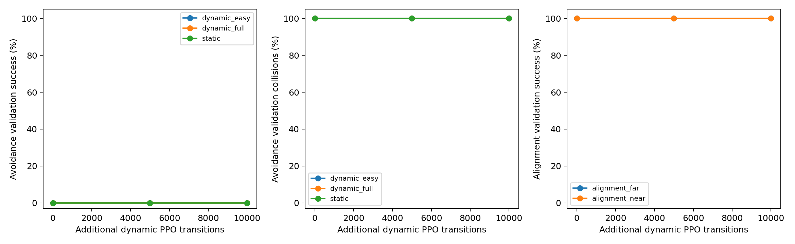

# 自主动态避障 PPO 短试验

追加训练 10,000 步；源模型累计 5,000 步；新计数 15,000 步。完成训练回合 767 个。训练及三次验证耗时 35.06 秒，不含场景库生成。

场景已缓存，执行中不调用 RRT，失败回合通常很短，因此本轮比逐回合重新规划的静态试验快。预算与计数已核对。

## 最终保存权重的验证结果

| 条件 | 成功 | 碰撞 | 越界 | 超时 |
|---|---:|---:|---:|---:|
| alignment_far | 10/10 | 0 | 0 | 0 |
| alignment_near | 10/10 | 0 | 0 | 0 |
| dynamic_easy | 0/10 | 10 | 0 | 0 |
| dynamic_full | 0/10 | 10 | 0 | 0 |
| static | 0/10 | 10 | 0 | 0 |

低/完整运动、静态自主避障在初始、5k、10k 检查点均零成功。远/近对准各 10/10，保留了对准能力。
这些结果证明接口运行及动作学习已发生，但没有证明学会了动态避障。

## 训练回合分布

| 课程 | 终止原因 | 回合数 |
|---|---|---:|
| alignment | success | 142 |
| dynamic | collision | 372 |
| dynamic | success | 4 |
| static | collision | 242 |
| static | success | 7 |

20/30/50 是按回合抽样概率，实际比例和训练步数占比不保证精确相等。未结束的回合不计入完整回合数。

## 模型选择和失败解释

按预定规则选中 0 个新增动态步的检查点，即带零残差网络的源策略初始化；final_model.zip 保存实际训练后的 10k 权重。未覆盖源模型，未追加预算。
冻结的跟踪系数及标准差没有变化；残差网络确实发生更新。原模型仅跟踪未考虑障碍物的参考，参考线上布置了障碍物，因此初始化避障验证也全部碰撞。
此前静态 89/90 使用 RRT 避障路径；本轮 RRT 只生成障碍物放置前的参考。两者任务不同，不能将本轮零成功直接解释为原静态系统退化。
50 个验证初始状态上，最终与初始化动作的平均绝对差 0.004077，最大差 0.011543（归一化动作）。
新网络初始输出为零、标准差沿用 0.02（约每关节 0.08° 探索尺度），KL/clip 较保守。这些设置及短预算可能限制大幅绕行动作的发现；这里只是可能原因，尚未做因果对照。
小运动幅度只代表运动强度较低，不保证几何问题更容易：同锚点改变幅度会同时改变给定相位下的实际位置。完整包络保护了起点/终点，不保证中间存在可行路线。
下一步应单独设计探索强度、渐进障碍数量/布局及奖励的对照，先检查低难度成功，再决定长训练；本次未自动修改这些设定。

## 数据与复现范围

128 个训练布局，每回合随机相位；10 个独立于训练的动态验证布局及原有 20 个对准案例，组成 50 个验证案例。每次验证三种方法，三次共 450 回合。无观测噪声、无延迟。
方法为 reference_servo / source_ppo / dynamic_ppo，共享布局、相位和未考虑障碍物的参考；没有在线规划、碰撞动作拒绝或专家接管。全局参考仍由 RRT 提供，因此不是完全无规划输入的端到端策略。
未执行预留独立测试集；单训练种子、每动态条件仅 10 个验证场景，不支持泛化结论。

模型目录：`models/dynamic_autonomous_pilot_seed61/`；场景库：`data/dynamic_autonomous_pilot_seed61/`（均在工作副本内）。

