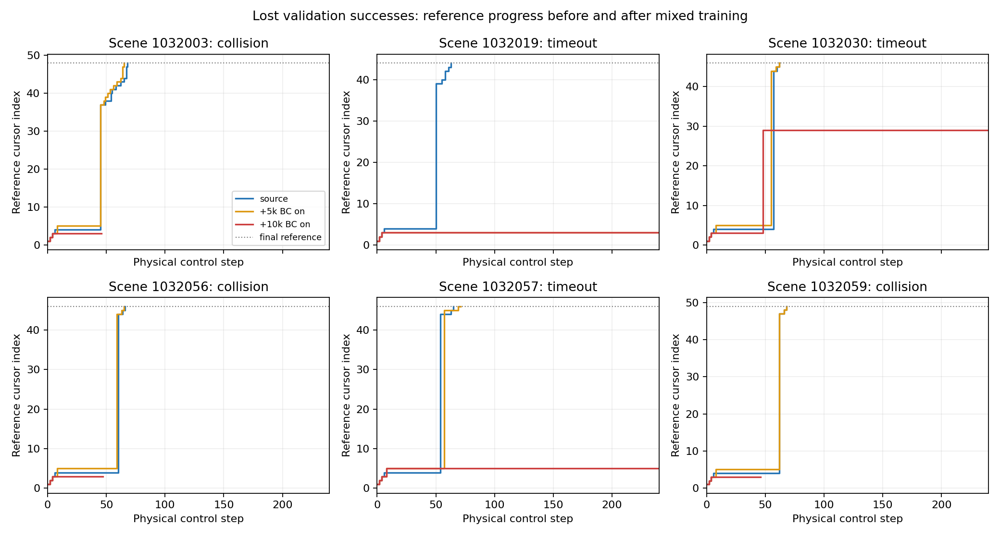

# Mixed-training regression diagnosis

Six validation scenes succeeded at step 0 but failed at step 10,000. All 18 deterministic replays (six scenes, three checkpoints) exactly reproduced their saved termination reasons and step counts. No model was trained or changed.

| Seed | Final reason | Steps | Position error (m) | Orientation error (deg) | Reference index / last | Contact |
|---|---|---:|---:|---:|---|---|
| 1032003 | collision | 47 | 0.6348 | 49.11 | 3 / 48 | panel / obstacle 4 |
| 1032019 | timeout | 240 | 0.2025 | 23.23 | 3 / 44 | none |
| 1032030 | timeout | 240 | 0.5550 | 58.69 | 29 / 46 | none |
| 1032056 | collision | 48 | 0.4800 | 38.91 | 3 / 46 | panel / obstacle 4 |
| 1032057 | timeout | 240 | 0.2862 | 28.87 | 5 / 46 | none |
| 1032059 | collision | 47 | 0.5970 | 47.94 | 3 / 49 | panel / obstacle 4 |

## Evidence and interpretation

- All three new collisions involve the panel and obstacle slot 4 at steps 47–48. The retained reference index is 3, although the immutable original path has 46–49 as its final index.
- Two new timeouts retain early indices 3 and 5. Their last-30-step joint displacements are only 0.00106 and 0.00122 rad. Each makes three conditional recovery attempts with zero accepted recoveries. The third timeout retains index 29/46, has 0.04774 rad last-30-step displacement, and makes no conditional recovery attempt. This is consistent with stagnation or slow drift during traversal rather than a final installation tolerance problem.
- Across these final-checkpoint trajectories, the maximum per-joint normalized mean-action difference from the initial model, evaluated on the *same* observation, ranges from 0.01467 to 0.01608. These are small one-step changes (at most about 0.0643 degrees under a 4-degree action scale), but closed-loop state trajectories and reference advancement diverge. This associates the failures with accumulated controller drift and discrete reference advancement; it does not establish which training loss caused the drift.
- Original reference arrays are unchanged in every replay. There is no evidence that the immutable reference path itself was overwritten. The current reference cursor can nevertheless stop advancing.
- In the saved training-only expert pool, 35 initial-observation groups (matched after rounding features to six decimal places) have repeated RRT action labels; 32 groups have at least one joint with opposite-sign labels of magnitude greater than 0.05. Different valid RRT routes can yield different actions at the same observed state. This makes averaging labels a plausible concern for auxiliary BC, but does not prove that auxiliary BC caused the regression.

## Controlled follow-up

The no-BC ablation starts from the exact same original PPOv5 source, uses the same 192 training scenes, 64 validation scenes, seed 61, case probabilities, reward units, PPO optimizer state and hyperparameters, and 50/50 episode routing. The sole algorithm setting changed is `auxiliary_bc.updates_per_rollout: 1 -> 0`. It runs 5,000 additional PPO transitions and must be compared with the earlier run at **5,000**, not at 10,000. RRT episodes remain enabled and count separately. This is a single-seed validation comparison; no independent test is used.

Files: `episodes.csv` / `episodes.json` give per-scene metrics, `traces/` contains actions and reference progress, `repeated_initial_expert_labels.json` contains the label audit, and `protocol.json` / `summary.json` record hashes and replay checks.

All six failed conditional recovery attempts in the two stalled scenes have their nearest forward reference segment outside the extended 0.45-rad joint-space radius (see `recovery_geometry.json`). The third timeout does not satisfy the little-motion gate.

The ten auxiliary-BC guard KL values were only 1.04e-07 to 6.25e-07 on sampled guard states. Small accepted updates do not guarantee unchanged long-horizon behavior, but their magnitude also cautions against assigning all drift to BC without the ablation.
