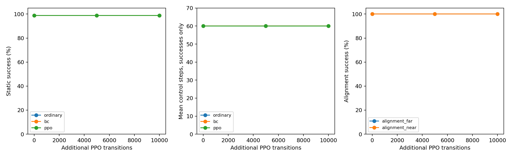

# Static waypoint PPO pilot results

Completed 10,000 additional transitions; 162 completed training episodes; elapsed 15.07 minutes.

| Additional steps | Method | Static successes | Collisions | Planning failures | Mean successful control steps | Far alignment | Near alignment |
|---:|---|---:|---:|---:|---:|---:|---:|
| 0 | ordinary | 89/90 | 0 | 1 | 60.02247191011236 | 100% | 100% |
| 0 | bc | 89/90 | 0 | 1 | 60.02247191011236 | 100% | 100% |
| 0 | ppo | 89/90 | 0 | 1 | 60.02247191011236 | 100% | 100% |
| 5000 | ordinary | 89/90 | 0 | 1 | 60.02247191011236 | 100% | 100% |
| 5000 | bc | 89/90 | 0 | 1 | 60.02247191011236 | 100% | 100% |
| 5000 | ppo | 89/90 | 0 | 1 | 60.01123595505618 | 100% | 100% |
| 10000 | ordinary | 89/90 | 0 | 1 | 60.02247191011236 | 100% | 100% |
| 10000 | bc | 89/90 | 0 | 1 | 60.02247191011236 | 100% | 100% |
| 10000 | ppo | 89/90 | 0 | 1 | 60.02247191011236 | 100% | 100% |

Selected checkpoint: 5000 additional steps.
Selection prioritizes static success, collision rate, alignment retention, then successful control steps. A checkpoint at zero means retaining the BC initialization.
All comparisons share a freshly planned path per scene within a validation event. Finite planning timeouts can change between events. These reused validation scenes are not an independent generalization test.
The actor learns servo gain/bias coefficients; route planning remains RRT. No independent test, dynamic extension or automatic longer training is included.

