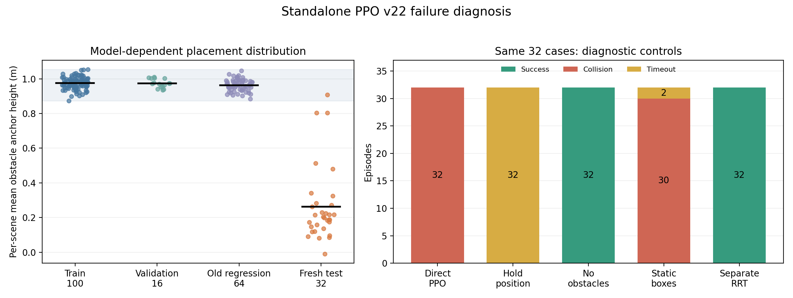

# Standalone PPO v22: failure diagnosis

No learning, checkpoint selection or task modification was performed. All frozen banks and model files remain unchanged. The 144 canonical reruns exactly reproduce the recorded outcomes, step counts and terminal errors. The main diagnostic contains 372 rollouts, plus two paired generator probes (four preliminary-route executions).

## Main finding

The new32 failure is a collision-avoidance failure under a strongly shifted placement distribution. Initial geometry and the tested action/observation interfaces are consistent. The task is physically solvable by the available planner on all32 cases. At the same time, direct policy performance is weak even on the training bank: 30 successes, 46 collisions and 24 timeouts, versus the source's 31 successes, 36 collisions and 33 timeouts in its collection rollouts. Distribution shift therefore does not explain away the model's incomplete learning.

## Controlled checks on exactly the same 32 new cases

| Execution/control | Success | Collision | Timeout | Interpretation |
|---|---:|---:|---:|---|
| Selected PPO, original moving obstacles | 0 | 32 | 0 | Original failure reproduced |
| Zero actions, original moving obstacles | 0 | 0 | 32 | No spontaneous start-state collision while holding position |
| Selected policy, obstacles removed | 32 | 0 | 0 | Base tracking/alignment can complete these references |
| Selected policy, obstacles frozen at initial positions | 0 | 30 | 2 | Moving-obstacle timing is not the only problem |
| Separate time-aware RRT baseline | 32 | 0 | 0 | All32 tasks have demonstrated solutions within the unchanged budget |

These controls are diagnostics, not replacements for the original independent-test score. Removing obstacles changes the observation masks and disables the obstacle correction, so that control checks the retained tracking pathway as well as removing collision geometry.

## Collision timing and objects

Selected PPO collides at a median control step of **20.5**, with median physical elapsed time **1.010 s**. There are zero initial collisions and zero episodes requiring joint-bound projection. First-collision episodes include panel-O3 in **16/32** and panel-O1 in **10/32**. Contact categories can overlap within one episode; complete robot-link IDs, contact points and penetration distances are in `rollouts.json`.

## Placement distribution

The observation dimensions, action interpretation, four obstacle sizes, and configured motion bounds are unchanged. Obstacle placement is not independent of the model: `fresh_vertical_corridor_case()` runs `preliminary_route(model, ...)`, then `fit_motion_anchors()` positions boxes along that model-dependent physical route. v21 training cases were generated using the older placement model; fresh32 used the adapted v21 model. A failed preliminary execution is intentionally not a rejection condition.

| Bank | Scenes | Mean anchor z (m) | Mean anchor y (m) | Preliminary success / timeout |
|---|---:|---:|---:|---|
| train | 100 | 0.975 | 0.511 | 100 / 0 |
| validation | 16 | 0.974 | 0.511 | 16 / 0 |
| old64 | 64 | 0.963 | 0.525 | 64 / 0 |
| fresh32 | 32 | 0.263 | 0.739 | 14 / 18 |

The training range of **per-scene mean anchor height** is 0.874-1.055 m. **31/32** fresh cases lie outside it. Fresh32 contains **30/128** anchors below world z=0; training contains none. The current generator has no ground-height constraint. This is a coverage/working-volume issue; it does not by itself invalidate the original task definition or permit discarding failed tests.

The paired probe uses the same preliminary scene for each model, without changing geometry between its two runs:

| Seed | Placement-guide model | Outcome | Steps | Mean panel z (m) |
|---|---|---|---:|---:|
| 1225004 | old_v20 | success | 62 | 0.838 |
| 1225004 | adapted_v21 | success | 164 | 0.373 |
| 1225006 | old_v20 | success | 64 | 0.886 |
| 1225006 | adapted_v21 | timeout | 240 | 0.232 |

This controlled probe supports the generator-coupling mechanism. It is a two-case illustration, not an estimate of its prevalence over all seeds.

## Interface checks and limits

Four representative cases, one from each bank, passed manual 77-feature reconstruction, target orientation checks, source/selected policy forward-predict-distribution mean equality, and likelihood consistency. Training-adapter and evaluation-wrapper reset observations and one-step transitions/rewards matched. All 212 distinct canonical scenes (244 rollouts because fresh32 uses two models) passed the same environment's reset/physics checks; 144 had prior reference outcomes available and reproduced them. No train/eval action-interface mismatch was found by these checks; this is not a proof that every possible software issue is absent.

## Recommended next development

1. Freeze a versioned placement-guide model or make route construction independent of the candidate policy. Use the same declared generator/workspace for training, validation and final test. Keep current failed results intact.
2. Generate new training seeds that cover both the previous high layout and lower/harder routes. Do not copy these32 inspected test cases into the training bank.
3. First check whether the direct actor can solve a small fixed training bank reliably after corrective imitation. Current 30/100 training success means this prerequisite is not met. Diagnose action-label disagreement and trajectory drift before extending PPO budgets.
4. Collect corrections at the student's own collision-approach states on those training scenes, then validate direct-policy collision/success tradeoffs. Preserve original success tolerances and episode limits.
5. Treat fresh32 as an inspected diagnostic bank after this work. Freeze another untouched test bank before the next final comparison; never select checkpoints using final-test outcomes.

## Evidence

- `analysis_summary.json`: machine-readable conclusions and counts.
- `scene_geometry.json`: scene-level placement/motion/reference features.
- `rollouts.json` and `episode_diagnostics.csv`: all measured outcomes and contacts.
- `interface_checks.json`: representative input/action/step consistency checks.
- `paired_generator_probe.json`: matched-scene route probe.
- `verification.json`: immutable-input and reproduction checks.
